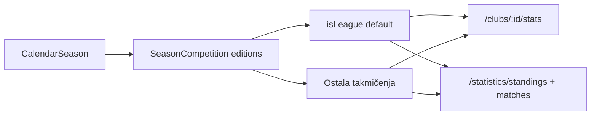

# Track 34 — Liga/Tim/Uživo polish (prije P2 staff)

P2 staff (dashboard, gallery-manage, orders, EntityList) **ne kreće u ovoj iteraciji**. Poslije ovog polish-a.

Pravila: dark-only, fajlovi ≤200, i18n BS/EN, bez commita, **ne dirati showcase intercept** u [`mobile/app/(tabs)/_layout.tsx`](mobile/app/(tabs)/_layout.tsx) / [`mobile/app/_layout.tsx`](mobile/app/_layout.tsx) (samo `headerRight` za search).

Backend već podržava filter: `GET /clubs/:id/stats?seasonId=<editionId>` i `GET /seasons` vraća `competitions[]`. Mobile Liga danas u [`load-league-screen.ts`](mobile/src/components/league/load-league-screen.ts) uzima samo `isLeague` edition.

---

## 1. Tim + Klub — filter statistike po takmičenju

**Problem:** [`TeamSeasonSummary`](mobile/src/components/team/TeamSeasonSummary.tsx) crta jedan default (liga). Klub može imati Liga + Kup u istoj sezoni.

**Pristup (kao web [`TeamSeasonStatsSection`](frontend/src/components/team/TeamSeasonStatsSection.tsx), uži scope):**

- Novi [`mobile/src/lib/club-participation.ts`](mobile/src/lib/club-participation.ts): port `pickDefaultParticipation` + filter `isActive` (aktivna kalendarska sezona).
- Novi `TeamSeasonStatsBlock` (container, `clubId`):
  - `GET /clubs/:id/participations`
  - chipovi = takmičenja **samo u aktivnoj sezoni** (sakriti ako je 1)
  - default = `isActive && isLeague`
  - `GET /clubs/:id/stats?seasonId=<editionId>`
  - render postojećeg `TeamSeasonSummary` (ostaje presentational)
- [`load-team-screen.ts`](mobile/src/components/team/load-team-screen.ts) (~197 linija): dodati `clubId` u `TeamScreenData`.
- [`team.tsx`](mobile/app/team.tsx) i [`clubs/[slug].tsx`](mobile/app/clubs/[slug].tsx): zamijeniti gol `TeamSeasonSummary` sa `TeamSeasonStatsBlock`.
- Proširiti `ClubParticipation` u [`load-club-public.ts`](mobile/src/components/club/load-club-public.ts) sa `competitionName` (chip label).

Ne dirati formaciju/roster/hero. `ClubCompetitionSection` (kola/tabela) ostaje.

i18n u [`mobile/src/i18n/team.ts`](mobile/src/i18n/team.ts): npr. `teamCompetition`, `teamLeagueChip`.

---

## 2. Liga — competition filter + wow bez rewrite-a

Layout ostaje: Hero → chipovi → tabela → mečevi → lideri.

**Filter:**

- Proširiti [`league-season.ts`](mobile/src/lib/league-season.ts): `mapCalendarEditions()`, `pickDefaultEditionId()` (liga pa prvi).
- [`league.tsx`](mobile/app/league.tsx): state `editionId`; pri change sezone reset edition + round.
- Chipovi takmičenja preko postojećeg [`LeagueSeasonChips`](mobile/src/components/league/LeagueSeasonChips.tsx) (sakriti ako ≤1).
- `loadLeagueScreen(calendarId, upToRound, editionId)` — svi API pozivi idu na izabrani edition, ne hardcodirani `leagueEditionId`.
- Hero: kicker/subtitle = ime takmičenja · sezona (ne generic „Prvenstvo“).

**Wow (isti skelet, jači vizual):**

- [`LeagueMatchesSection`](mobile/src/components/league/LeagueMatchesSection.tsx): scoreboard red (grb | ime | rezultat | ime | grb), LIVE badge — dijeljeni red s Uživo listom da ne dupliramo.
- [`LeagueLeadersSection`](mobile/src/components/league/LeagueLeadersSection.tsx): podium boje ranga 1–3 (kao [`HomeLeagueRowItem`](mobile/src/components/home/HomeLeagueRowItem.tsx)).
- [`LeagueHero`](mobile/src/components/league/LeagueHero.tsx): competition name u kickeru.

Ako `load-league-screen.ts` (163) prijeđe 200 → izvući `mapLeaders`/`mapRounds` u helper.

---

## 3. Pretraga — header, ne tab bar

Tabovi ostaju 5 (Home / News / Live / More / Profile).

- Novi mali `HeaderSearchButton` → `router.push('/search')`.
- [`(tabs)/_layout.tsx`](mobile/app/(tabs)/_layout.tsx): `headerRight` = search + postojeći login/profil. **Ne dirati** `feature.showcaseMode` granu.
- [`HomeHeroBlock`](mobile/src/components/home/HomeHeroBlock.tsx): search ikona gore-desno (safe area) jer Home nema header.
- More `ListRow` za search ostaje kao sekundarni ulaz.

---

## 4. Uživo — scoreboard polish

Lista [`live/index.tsx`](mobile/app/(tabs)/live/index.tsx) + [`LiveMatchRow`](mobile/src/components/live/LiveMatchRow.tsx) danas je „ime vs ime“ + meta.

- `LiveMatchRow` → horizontalni scoreboard (grbovi, rezultat ili vrijeme, LIVE pulse).
- Ako ima LIVE mečeva: prvi kao featured kartica (veći score, minuta).
- Meta: `match.season.competition.name` + kolo (`roundRel`) — API već šalje preko `withSeasonAlias`; proširiti [`Match`](mobile/src/types/api.ts).
- Detalj [`live/[id].tsx`](mobile/app/live/[id].tsx): grbovi u scoreboardu, i18n status (ne raw `HALFTIME`), venue. Izvući `LiveScoreboard` da ekran ostane ≤200.

i18n: mali [`mobile/src/i18n/live.ts`](mobile/src/i18n/live.ts) (`matchLive`, `matchHalftime`, `matchFinished`, `matchScheduled`, …).

---

## Redoslijed

1. Shared chips + participation util + `TeamSeasonStatsBlock` (Tim/Klub)
2. Liga edition filter + hero/matches/leaders polish
3. Header search
4. Uživo lista + detalj
5. `npx tsc --noEmit` u `mobile/`
6. Update [`HANDOFF.md`](.cursor/plans/fk-gracanica/34_mobile-to-100/HANDOFF.md) + [`CHECKLIST.md`](.cursor/plans/fk-gracanica/34_mobile-to-100/CHECKLIST.md) + [`CHANGELOG.md`](.cursor/plans/fk-gracanica/34_mobile-to-100/CHANGELOG.md)

Van opsega: P2 staff, Play Store, showcase intercept, commit.
