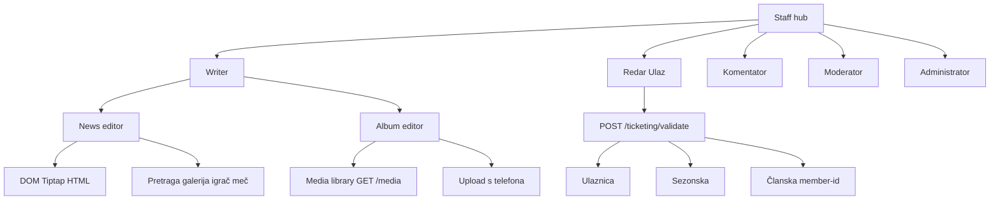

# Track 35 — Staff complete (mobile)

Nastavak Track 34. Originalni P2 (4 rupe) je preuzak. Ovo je **kompletan staff** po ulogama. Public Liga/Tim/Uživo i showcase intercept se ne diraju. Bez commita dok ne kažeš. Dark-only, fajlovi ≤200, i18n BS/EN.

**Editor odluka:** body vijesti = Expo DOM / WebView (Tiptap kao na webu). Naslov, cover, meta, veze, albumi = native.

Dokumentacija pri execute: [`.cursor/plans/fk-gracanica/35_staff-complete/`](.cursor/plans/fk-gracanica/35_staff-complete/) (`00_overview.md` + faze). Track 34 faza 03 se smatra **zamijenjenom** ovim trackom; 34 ostaje Play Store.

---

## 1. Writer — vijest kao na webu

Web izvor: [`NewsEditorPage.tsx`](frontend/src/pages/admin/news/NewsEditorPage.tsx), [`NewsEditorMain.tsx`](frontend/src/pages/admin/news/NewsEditorMain.tsx), [`NewsEditorMeta.tsx`](frontend/src/pages/admin/news/NewsEditorMeta.tsx), [`RichTextEditor.tsx`](frontend/src/components/admin/RichTextEditor.tsx). API već prima sva polja ([`NewsWriteInput`](backend/src/news/news.service.ts)).

**Native forma** (split fajlovi): lista nacrta → `/staff/writer/[id]` create/edit.

Polja (isti payload kao web):

- title, slug (auto iz naslova), excerpt, categoryId, coverPath (MediaPicker + upload)
- videoUrl, tags (csv), seoTitle, seoDesc, scheduledAt
- galleryId, relatedPlayerIds[], relatedMatchIds[]
- content = HTML iz DOM editora
- akcije: sačuvaj draft (`POST/PATCH /news`), submit (`PATCH /news/:id/submit`)

**Body editor:** novi `NewsBodyDomEditor` sa `'use dom'` (Expo DOM, skill `use-dom`). Tiptap toolbar kao web: B/I/U, H2/H3, liste, quote, HR, link, slika (media picker callback), YouTube URL. Output HTML string. Deps: `react-native-webview` + Tiptap u mobile (DOM bundle). Rebuild dev clienta.

**Veze — pretraga, ne dump svih chipova.** Web `EntitySelect` učitava sve; na mobitelu `EntitySearchSheet`:

- debounce 300ms
- Igrači: `GET /players` + filter ime
- Utakmice: `GET /matches` + filter klub/datum
- Galerija: `GET /gallery` (svi statusi — javni `/search` vraća samo PUBLISHED, ne koristiti za writer)

Single select za galeriju, multi za igrače/mečeve. Chipovi odabranih iznad searcha.

Ne koristiti public [`/search`](backend/src/search/search.service.ts) za ove veze.

---

## 2. Writer — album kao na webu

Web: kreiraj album → edit ekran → vidiš postojeće slike → dodaješ nove ([`GalleryEditorPage.tsx`](frontend/src/pages/admin/gallery/GalleryEditorPage.tsx) + [`GalleryPhotoPicker.tsx`](frontend/src/components/admin/GalleryPhotoPicker.tsx)).

API: `POST /gallery`, `GET /gallery/:id`, `POST /gallery/:id/photos` `{ path }`, `DELETE .../photos/:photoId`, `POST .../photos/reorder`. Biblioteka: `GET /media` + `GET /media/folders` ([`media.controller.ts`](backend/src/media/media.controller.ts)). Writer već ima `gallery.manage` + `media.read` + `media.upload`.

**Mobile tok:**

1. Lista albuma (`/staff/gallery-manage`) — status, broj slika, tap → editor
2. Create: naslov + opis → `POST` → `router.replace` na editor (kao web)
3. Editor `/staff/gallery-manage/[id]`: grid postojećih thumbova; caption/delete; **Odaberi iz biblioteke** (multi, search, već dodane označene); **Upload s telefona** (`uploadMedia`); opciono **Dodaj mapu** ako folders API ostane jednostavan
4. Submit albuma na review ako Writer nema `gallery.approve` (postojeći status endpoint)

Zamjenjuje današnji jedan ekran koji samo create + jedan upload ([`gallery-manage.tsx`](mobile/app/staff/gallery-manage.tsx)).

---

## 3. Komentator — full, polish

Ekran i paneli već postoje ([`commentator.tsx`](mobile/app/staff/commentator.tsx) + Clock/Events/Comment/Stream/Report/Stoppage).

- Desk: default filter LIVE + danas SCHEDULED + izvještaji pending (ne svi historijski mečevi)
- Live semafor: trenutni rezultat/minuta pored selectora (`useLiveMatch` / socket)
- i18n statusa (reuse `matchLive` / `matchHalftime`)
- loading/error/retry; paneli collapsed dok meč nije LIVE
- Submit izvještaja ostaje; Moderator i dalje approve

Bez novog live API-ja.

---

## 4. Moderator — minimum + UX

[`moderation.tsx`](mobile/app/staff/moderation.tsx): tri queue-a, approve/draft, bez previewa.

- ListSkeleton, error, pull-to-refresh
- Kartica: naslov + meta; preview sheet (excerpt / cover) prije approve
- i18n status; prazna stanja
- Inbox link ako ima `contact.read` (već u admin hubu)

---

## 5. Administrator — minimum

Originalni P2, sada kao faza:

- **Dashboard:** skeleton, error/retry, KPI kartice 2-col ([`dashboard.tsx`](mobile/app/staff/admin/dashboard.tsx))
- **Orders:** status + refund preko postojećih `confirm-refund` / `admin/orders/:id/cancel`
- **EntityList slike:** field type `image` + native MediaPicker (upload ili biblioteka) za trophies/HOF/museum/sponsors/clubs — ne raw `logoPath` tekst
- **Users:** search filter; roles try/catch

Web-only i dalje van opsega: CMS DnD, formation editor, media-tree reorganize.

---

## 6. Redar + Ulaz (ulaznice, sezonske, članske)

Danas: uloga ne postoji; [`POST /ticketing/validate`](backend/src/ticketing/ticketing.controller.ts) traži `ticketing.manage`; sezonska već pada u [`validateTicket`](backend/src/ticketing/ticketing.service.ts); članska QR je `member-{id}` ([`membership.service.ts`](backend/src/membership/membership.service.ts)) i **nije** u validate toku.

**BE:**

- Permission `admissions.scan` u [`permissions.ts`](backend/src/common/constants/permissions.ts)
- Uloga **Redar** u [`rbac.ts`](backend/prisma/seed/rbac.ts) + [`SYSTEM_ROLES`](frontend/src/lib/rbac-constants.ts)
- Validate: `RequireAnyPermission('admissions.scan', 'ticketing.manage')`
- `validateTicket`: ako nije ticket/pass, lookup `membershipCard.qrCode` → `{ kind: 'membership', status, name }` (ACTIVE vs ostalo)
- `sync-permissions` na boot i dalje daje nove keyeve Administratoru

**Mobile:**

- Hub kartica **Ulaz** za Redar (i Admin kao prečica)
- Isti skener ([`validate.tsx`](mobile/app/staff/admin/validate.tsx)): rezultat kartica Valjano / Iskorišteno / Nevažeće + kind (ulaznica / sezonska / članstvo)
- Redar **ne vidi** orders/refund/cjenovnik

Ime uloge: **Redar**. Ekran: **Ulaz**.

---

## 7. Hub IA + polish

[`staff/index.tsx`](mobile/app/staff/index.tsx): Writer, Galerija, Komentator, Moderator, Ulaz, Admin — samo po permissionima. Count stripovi. Konzistentni skeleti, empty, i18n.

---

## Redoslijed execute

1. Writer vijest (forma + DOM editor + relation search) — najveći rizik (webview dep)
2. Album editor (biblioteka + upload + grid)
3. Komentator desk filter + semafor
4. Moderator queue UX
5. Admin dashboard/orders/images
6. BE Redar + membership QR + Ulaz UI
7. Hub + `tsc` + HANDOFF/CHECKLIST/CHANGELOG 35

Van opsega: Play Store (Track 34 faza 04), CMS builder, showcase intercept.
