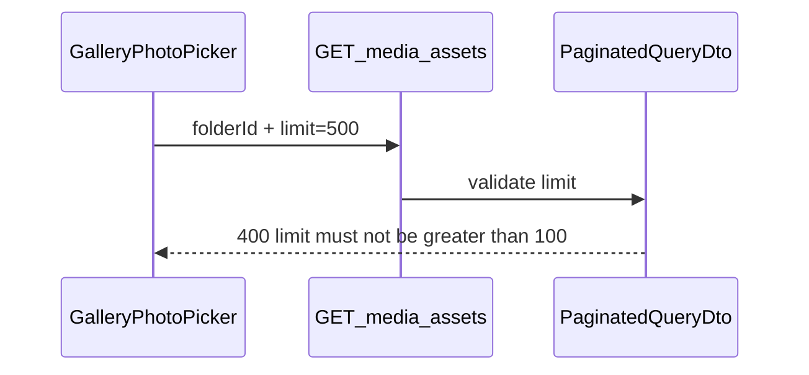

# Fix: „limit must not be greater than 100" pri dodavanju mape u galeriju

## Uzrok

U [`frontend/src/components/admin/GalleryPhotoPicker.tsx`](frontend/src/components/admin/GalleryPhotoPicker.tsx) funkcija `addFromFolder` direktno zove API:

```42:44:frontend/src/components/admin/GalleryPhotoPicker.tsx
const res = await api.get<{ data: MediaAsset[] }>('/media/assets', {
  params: { folderId, limit: 500, page: 1 },
});
```

Backend DTO [`backend/src/common/dto/paginated-query.dto.ts`](backend/src/common/dto/paginated-query.dto.ts) ima `@Max(100)` na `limit`, pa **bilo koji** request sa `limit > 100` vraća `400` — čak i za mape sa samo 6 slika.



## Rješenje

Dodati mali helper za dohvat **svih** asseta iz mape kroz paginaciju (max 100 po stranici), pa ga koristiti u `addFromFolder`.

### 1. Novi helper — [`frontend/src/lib/fetch-all-media-assets.ts`](frontend/src/lib/fetch-all-media-assets.ts) (~35 linija)

```typescript
const PAGE_LIMIT = 100;

export async function fetchAllMediaAssetsInFolder(folderId: string): Promise<MediaAsset[]> {
  const all: MediaAsset[] = [];
  let page = 1;
  let totalPages = 1;

  do {
    const res = await api.get<PaginatedResponse<MediaAsset>>('/media/assets', {
      params: { folderId, page, limit: PAGE_LIMIT },
    });
    all.push(...asArray(res.data.data));
    totalPages = res.data.meta.totalPages;
    page += 1;
  } while (page <= totalPages);

  return all;
}
```

- `PAGE_LIMIT = 100` — u skladu sa backend `@Max(100)`
- Radi i za male mape (6 slika) i za veće (100+ slika, više stranica)

### 2. Izmjena — [`frontend/src/components/admin/GalleryPhotoPicker.tsx`](frontend/src/components/admin/GalleryPhotoPicker.tsx)

U `addFromFolder` zamijeniti direktni `api.get` sa:

```typescript
const assets = await fetchAllMediaAssetsInFolder(folderId);
const paths = assets.map((a) => a.originalPath);
await addPaths(paths);
```

Ukloniti neiskorišteni `api` import ako više nije potreban u ovom fajlu.

### 3. (Opcionalno) UX poboljšanje

Ako mapa ima puno slika, prikazati kratki status u dugmetu dok traje fetch (`Dodavanje…`). Nije obavezno za fix — postojeći `busy` state već disable-uje dugmad.

## Šta se ne mijenja

- Backend — validacija `@Max(100)` ostaje (ispravno zaštitno ograničenje)
- [`RichTextEditor.tsx`](frontend/src/components/admin/RichTextEditor.tsx) već koristi `limit: 100` — OK
- [`MediaPickerDialog`](frontend/src/components/admin/MediaPickerDialog.tsx) koristi `limit: 60` — OK

## Test plan

1. Mapa sa 6 slika → „Dodaj mapu" u galeriji → sve 6 se doda bez 400 greške
2. Mapa sa 0 slika → nema greške, ništa novo se ne doda
3. Mapa sa već dodanim slikama → duplikati se filtriraju (`addPaths` već radi `filter` po `existingPaths`)
4. (Ako postoji) mapa sa >100 slika → sve stranice se povuku i sve slike se dodaju
