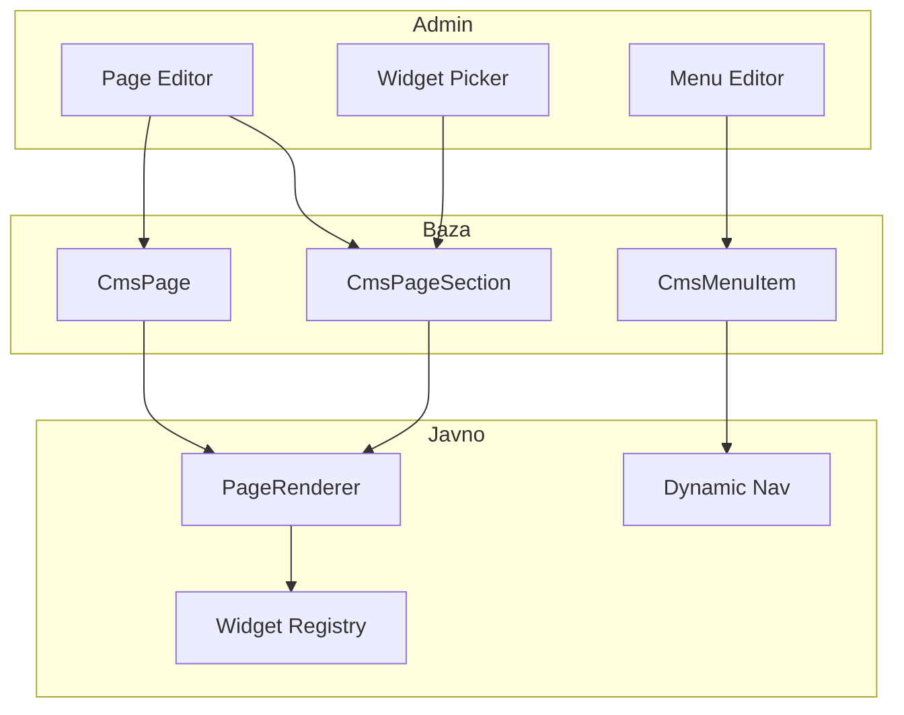

# CMS Page Builder — pregled

> **Status:** PLAN (čeka potvrdu)  
> **Zamjenjuje:** key-based `CmsBlock` (`home.hero`, JSON editor)  
> **Cilj:** Admin sastavlja stranice od widgeta, objavljuje, stavlja u meni — bez tehničkih ključeva.

---

## Problem (danas)

| Problem | Primjer |
|---------|---------|
| Tehnički ključevi | `home.hero`, `footer.about` — admin ne zna šta znači |
| Label ≠ link | CTA piše "Sljedeća utakmica" (i18n), link ide na `/liga` — promjena puta ne mijenja tekst |
| Blok bez mjesta | "Novi blok" nema gdje da se renderuje |
| Hardkodirana naslovna | `HomePage.tsx` — 11 sekcija fiksno u kodu |
| Hardkodirani meni | `PublicLayout` — `navItems` u kodu |

---

## Rješenje — 3 koncepta



1. **Widget** — tipizirana komponenta s ljudskim imenom i config shemom (Zod).
2. **Stranica** — ordered lista widget instanci + status (DRAFT/PUBLISHED) + slug.
3. **Meni** — stavke koje vode na stranicu, modul ili eksterni URL.

---

## Faze

| Faza | Šta | Exit |
|------|-----|------|
| **1** | Prisma + widget registry + API | Stranice/sekcije u DB, seed home |
| **2** | PageRenderer + migracija naslovne | `/` iz CMS-a, CTA label+link |
| **3** | Admin page builder UI | CRUD stranica, dodaj/uredi/poredaj widgete |
| **4** | Dinamički meni + custom rute | `/p/:slug`, meni iz baze |
| **5** | Interaktivni builder (opcionalno) | Preview, reorder drag-drop |

Faze 1–4 = MVP za gate CMS modula. Faza 5 = premium.

---

## Widget katalog (MVP)

### Layout / sadržaj
| Widget | Admin vidi | Config |
|--------|-----------|--------|
| Hero | "Hero baner" | naslov, podnaslov, godina, pozadina, **CTA dugmad [{label, url, stil}]** |
| Rich text | "Tekst blok" | HTML (TipTap) |
| CTA traka | "Poziv na akciju" | naslov, tekst, dugmad [{label, url}] |
| Razmak | "Razmak" | visina |

### Moduli (data-driven)
| Widget | Admin vidi | Config |
|--------|-----------|--------|
| Vijesti | "Vijesti" | način: zadnje N / istaknute / kategorija, limit, naslov sekcije, "Vidi sve" link |
| Galerija | "Galerija" | jedna galerija / zadnje N, limit |
| Sljedeća utakmica | "Sljedeća utakmica" | (auto iz modula) |
| Zadnji rezultat | "Zadnji rezultat" | (auto) |
| Liga tabela | "Tabela lige" | takmičenje (picker) |
| Igrači | "Istaknuti igrači" | limit, pozicija |
| Sponzori | "Sponzori" | tier filter |
| Trofeji | "Trofeji" | limit |
| Članstvo CTA | "Članstvo" | naslov, tekst, dugme |
| Ulaznice CTA | "Ulaznice" | naslov, tekst, dugme |
| Newsletter | "Newsletter" | naslov, opis |

### Globalno (layout)
| Widget | Gdje | Config |
|--------|------|--------|
| Footer o klubu | `PublicLayout` footer | tekst |

---

## Šema (Prisma — skica)

```prisma
model CmsPage {
  id          String        @id @default(cuid())
  slug        String        @unique
  title       String
  status      ContentStatus @default(DRAFT)
  seoTitle    String?
  seoDesc     String?
  isSystem    Boolean       @default(false) // home, footer — ne briše se
  sections    CmsPageSection[]
  menuItems   CmsMenuItem[]
  createdAt   DateTime      @default(now())
  updatedAt   DateTime      @updatedAt
}

model CmsPageSection {
  id         String   @id @default(cuid())
  pageId     String
  page       CmsPage  @relation(...)
  widgetType String   // npr. "hero", "news-feed"
  sortOrder  Int
  config     Json     // validira widget schema
  enabled    Boolean  @default(true)
}

model CmsMenu {
  id    String @id @default(cuid())
  key   String @unique // "main", "footer"
  items CmsMenuItem[]
}

model CmsMenuItem {
  id       String  @id @default(cuid())
  menuId   String
  label    String
  sortOrder Int
  pageId   String?  // CMS stranica
  path     String?  // ili fiksni path (/vijesti)
  externalUrl String?
  parentId String?  // podmeni
}
```

**Migracija:** `CmsBlock` → deprecate; seed pretvara `home.hero` u `CmsPage` slug=`home` + hero section.

---

## Admin UX (Faza 3)

```
/admin/cms
├── Stranice          → lista, status, "Uredi layout"
├── Meni              → main/footer stavke
└── (stari blokovi)   → ukloniti nakon migracije

/admin/cms/pages/:id
├── Meta: naslov, slug, SEO, Objavi
├── Lista sekcija (reorder ↑↓ ili drag)
├── [+ Dodaj widget]  → kategorije: Layout | Moduli | CTA
└── Klik na sekciju   → form po widget tipu (ne JSON)
```

---

## Javno (Faza 2–4)

- `GET /cms/pages/:slug` — stranica + sekcije (samo PUBLISHED)
- `GET /cms/menus/:key` — meni stavke
- `PageRenderer` — mapira `widgetType` → React komponenta iz registry-ja
- `/` → `home` stranica iz CMS-a
- `/p/o-nama` → custom CMS stranica
- Postojeći moduli (`/vijesti`, `/galerija`…) ostaju; meni može na njih linkati

---

## Faza 5 — interaktivno (kasnije)

- Split view: lijevo lista widgeta, desno live preview
- Inline edit teksta na previewu
- @dnd-kit reorder
- **Ne blokira MVP**

---

## Odluke za potvrdu

1. **Custom stranice URL:** `/p/:slug` (bez konflikta s modulima) ili root `/:slug`?
2. **Stari moduli:** ostaju hardcoded rute + mogu u meni, ili sve preko CMS stranica?
3. **Prioritet widgeta:** svi odjednom ili prvo hero+CTA+vijesti+galerija pa ostalo?
4. **Faza 5:** uključiti u ovaj sprint ili odgoditi?

---

## Procjena

| Faza | Fajlova ~ | Rizik |
|------|-----------|-------|
| 1 | 15–20 | DB migracija |
| 2 | 10–15 | Regresija naslovne |
| 3 | 15–20 | Admin UX |
| 4 | 8–10 | Routing + meni |
| 5 | 20+ | Scope creep |

**Preporuka:** Faze 1–3 u jednom gate ciklusu (CMS REVISE → novi gate), Faza 4 odmah nakon, Faza 5 odvojeno.
