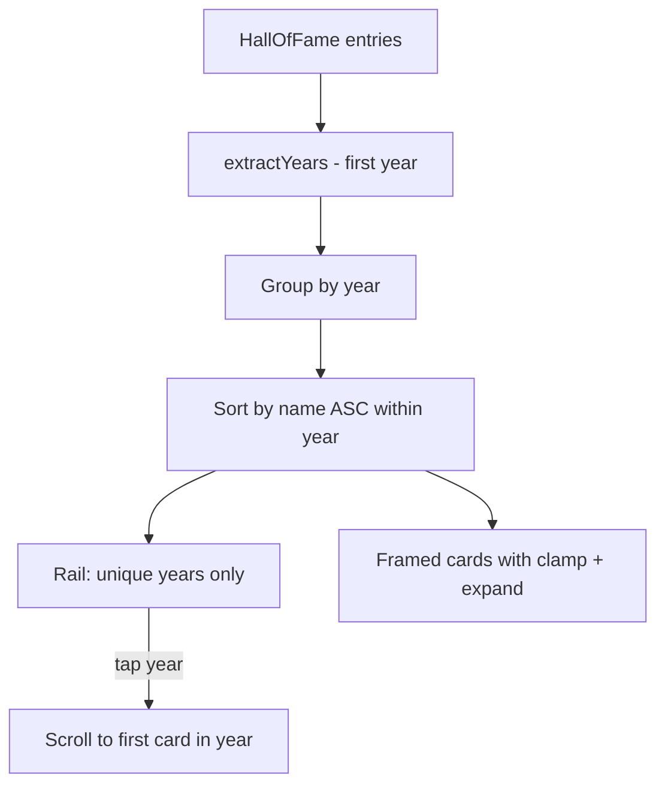
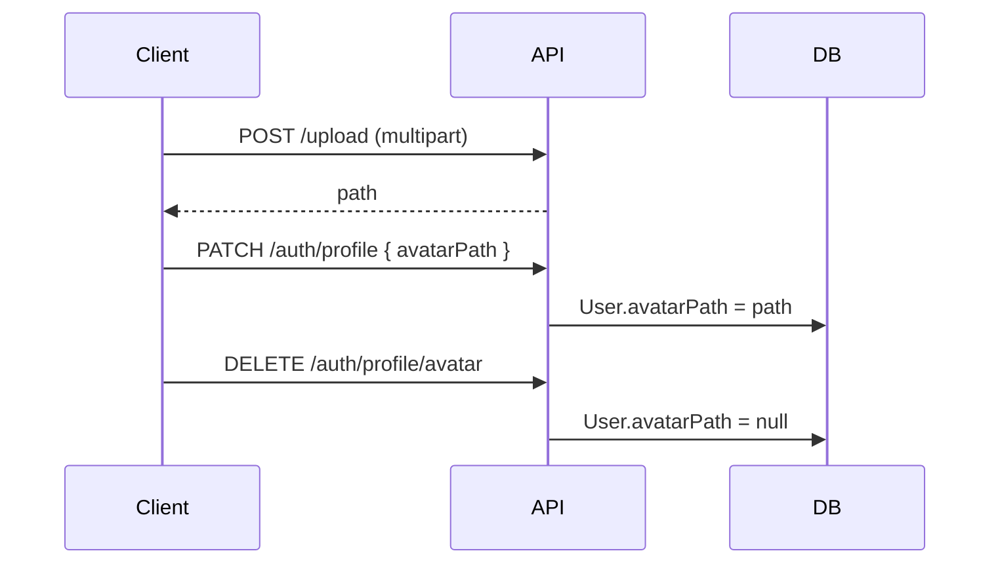

# Plan ispravki — Baština, navigacija, profil, admin

## Trenutno stanje (ključni nalazi)


| Područje             | Problem                                                                                                                                   | Lokacija                                                                                                                       |
| -------------------- | ----------------------------------------------------------------------------------------------------------------------------------------- | ------------------------------------------------------------------------------------------------------------------------------ |
| Timeline truncate    | Mobile koristi `numberOfLines={5}`                                                                                                        | `[mobile/src/components/heritage/HeritageTimelineChapter.tsx](mobile/src/components/heritage/HeritageTimelineChapter.tsx)` L25 |
| HoF rail             | 1 tick po legendi (ne po godini)                                                                                                          | `[mobile/src/components/heritage/HeritageHofTab.tsx](mobile/src/components/heritage/HeritageHofTab.tsx)` L13–24                |
| Pretraga             | Faceti: news/players/clubs/matches/galleries/trophies — **nema** timeline/HoF                                                             | `[backend/src/search/search-queries.util.ts](backend/src/search/search-queries.util.ts)`                                       |
| Heritage default tab | Fallback `'trophies'`                                                                                                                     | `[mobile/src/components/heritage/load-heritage.ts](mobile/src/components/heritage/load-heritage.ts)` L9                        |
| Tab bar              | Uživo = tab #3; Liga samo u More                                                                                                          | `[mobile/app/(tabs)/_layout.tsx](mobile/app/(tabs)`/_layout.tsx)                                                               |
| Home CTA             | Historija ispod galerije; match widget uvijek vidljiv                                                                                     | `[mobile/app/(tabs)/home.tsx](mobile/app/(tabs)`/home.tsx)                                                                     |
| Avatar               | Nema `avatarPath` na `User` modelu                                                                                                        | `[backend/prisma/schema.prisma](backend/prisma/schema.prisma)`                                                                 |
| Admin slika bug      | `imagePath                                                                                                                                |                                                                                                                                |
| Analitika            | Mobile tracking postoji (`trackMobileVisit` u `[mobile/app/_layout.tsx](mobile/app/_layout.tsx)` L19), ali nema geo; panel je samo tabela | `[AnalyticsVisitorsPanel.tsx](frontend/src/pages/admin/analytics/AnalyticsVisitorsPanel.tsx)`                                  |
| SEO                  | Samo `seo.title` + `seo.description`; sitemap bez dinamičkog sadržaja baštine                                                             | `[backend/src/seo/seo.service.ts](backend/src/seo/seo.service.ts)`                                                             |


---

## Faza 1 — Timeline: expandable opis

**Mobile** — `[HeritageTimelineChapter.tsx](mobile/src/components/heritage/HeritageTimelineChapter.tsx)`:

- Dodati lokalni `expanded` state
- Default: `numberOfLines={5}`; na tap „Pročitaj više“ / `readMore` i18n → ukloniti limit
- Reuse pattern iz `[mobile/src/i18n/common.ts](mobile/src/i18n/common.ts)` (`readMore`)

**Web** — `[ClubStoryChapter.tsx](frontend/src/components/public/story/ClubStoryChapter.tsx)`:

- Trenutno prikazuje cijeli HTML bez truncate; dodati opcionalni `ExpandableRichContent` helper (~40 lin) koji detektuje overflow (line-clamp + „Pročitaj više“) za dugačke opise

**Timeline year rail (mobile)** — opcionalno usklađivanje: `[HeritageTimelineTab.tsx](mobile/src/components/heritage/HeritageTimelineTab.tsx)` + `[ClubStoryProgress.tsx](frontend/src/components/public/story/ClubStoryProgress.tsx)` — deduplicirati godine u rail-u (1 tick po godini, scroll na prvi event te godine). Nije eksplicitno traženo ali smanjuje rail kao kod HoF.

---

## Faza 2 — Kuća slavnih: rail po godini + kartice




**Nova util** — `[mobile/src/components/heritage/heritage-utils.ts](mobile/src/components/heritage/heritage-utils.ts)`:

```ts
groupHofByYear(items): { year: string; items: HeritageItem[] }[]
// year = extractYears(item.years)[0]; sort items by title localeCompare
```

**Refaktor** `[HeritageHofTab.tsx](mobile/src/components/heritage/HeritageHofTab.tsx)`:

- FlatList sekcije po godini (SectionList) umjesto 1 item = 1 legenda u rail-u
- Rail prima `{ id: year, label: year }[]` umjesto po-post ticks
- Active year iz vidljive sekcije

**Nova kartica** — `HeritageHofCard.tsx` (~80 lin):

- Okvir (border, shadow, padding) — gold accent kao postojeći `[HeritageHofChapter.tsx](mobile/src/components/heritage/HeritageHofChapter.tsx)`
- Bio: 4–5 linija + „Pročitaj više“

**Web** — `[HallOfFamePage.tsx](frontend/src/pages/public/HallOfFamePage.tsx)` + `[HofLegendCard.tsx](frontend/src/components/public/hall-of-fame/HofLegendCard.tsx)`:

- Grupisati prikaz po godini (sekcije sa naslovom godine)
- U kartici: zadržati `line-clamp-5` + inline „Pročitaj više“ toggle (dialog ostaje za puni profil)

---

## Faza 3 — Pretraga: timeline + kuća slavnih

**Backend** — proširiti `[search-queries.util.ts](backend/src/search/search-queries.util.ts)` + `[search-query.dto.ts](backend/src/search/dto/search-query.dto.ts)`:

- Novi faceti: `timeline` (`ClubTimelineEvent`: title, description), `hallOfFame` (`HallOfFameEntry`: name, role, bio, years)
- `countSearchFacets`, `findSearchFacet`, `previewAllFacets`, `emptySearchResponse`

**Frontend** — `[frontend/src/types/search.ts](frontend/src/types/search.ts)`, `[SearchPage.tsx](frontend/src/pages/public/SearchPage.tsx)`, `[SearchResultSections.tsx](frontend/src/components/search/SearchResultSections.tsx)`:

- Labele: „Timeline“, „Kuća slavnih“
- Linkovi: `/o-klubu` (timeline anchor po id) i `/hall-of-fame`

**Mobile** — `[mobile/src/lib/search-nav.ts](mobile/src/lib/search-nav.ts)`, `[mobile/app/search.tsx](mobile/app/search.tsx)`:

- `flattenSearchResponse`, `groupSearchItems`, `searchItemHref` za nova 2 tipa
- i18n ključevi u `[mobile/src/i18n/common.ts](mobile/src/i18n/common.ts)`

---

## Faza 4 — Mobilna navigacija i home layout

### 4a. Tab bar: Liga umjesto Uživo

`[mobile/app/(tabs)/_layout.tsx](mobile/app/(tabs)`/_layout.tsx):

- Zamijeniti `live/index` tab sa `(tabs)/league/index` (novi fajl, re-export sadržaja iz `[mobile/app/league.tsx](mobile/app/league.tsx)`)
- Label: `t('league')` / „Liga“
- `href: null` kad `!isEnabled('modules.competitions')`

`[mobile/app/(tabs)/more.tsx](mobile/app/(tabs)`/more.tsx):

- Ukloniti Liga red
- Dodati Uživo → `router.push('/(tabs)/live/index')` ili stack `/live` listu
- Novi i18n: `liveHint`

### 4b. Heritage default tab = timeline

`[load-heritage.ts](mobile/src/components/heritage/load-heritage.ts)` L9: fallback `'timeline'`

### 4c. Home: Historija ispod vijesti, sakriti Sljedeća utakmica

`[mobile/app/(tabs)/home.tsx](mobile/app/(tabs)`/home.tsx):

- Premjestiti `HomeHeritageCta` blok odmah nakon `HomeNewsSection` (prije featured players)
- Wrap `HomeMatchWidget` sekciju: `{featuredMatch ? <HomeFadeSection>...</HomeFadeSection> : null}`

**Web CMS** — `[backend/prisma/seed/demo/cms.ts](backend/prisma/seed/demo/cms.ts)`:

- Dodati `{ widgetType: 'club-about-cta' }` odmah nakon `news-feed`
- Ukloniti deprecated `next-match` widget iz seed-a (već vraća `null`)
- Hero dock već koristi `[isHeroMatchDockVisible](frontend/src/cms/widgets/hero/hero-match-utils.ts)` — doraditi `[HeroMatchDock.tsx](frontend/src/cms/widgets/hero/HeroMatchDock.tsx)` da ne prikazuje „Nema zakazane utakmice“ placeholder; cijeli dock sakriti kad nema `next` (last result može ostati u zasebnom widgetu `last-result`)

---

## Faza 5 — Avatar upload (web + mobile)




**Backend**:

- Migracija: `User.avatarPath String?`
- `[auth.controller.ts](backend/src/auth/auth.controller.ts)`: `PATCH /auth/profile`, `DELETE /auth/profile/avatar` (samo vlastiti profil)
- `[auth.service.ts](backend/src/auth/auth.service.ts)`: validacija path-a, brisanje starog fajla preko upload servisa
- `GET /auth/me` vraća `avatarPath`

**Web** — novi `ProfileAvatarEditor.tsx` (~90 lin) u membership/account sekciji + `[PublicUserMenu.tsx](frontend/src/components/layout/PublicUserMenu.tsx)` prikaz slike

**Mobile** — `[ProfileHub.tsx](mobile/src/components/profile/ProfileHub.tsx)`:

- `expo-image-picker` + upload + delete dugmad
- `RemoteImage` umjesto inicijala kad postoji avatar

---

## Faza 6 — Admin sidebar reorganizacija

`[admin-nav-groups.ts](frontend/src/components/layout/admin-nav-groups.ts)` — predložena struktura:


| Grupa            | Stavke                                                        |
| ---------------- | ------------------------------------------------------------- |
| **Pregled**      | Dashboard, Stanje, Analitika, Notifikacije, Audit, Javni sajt |
| **Sadržaj**      | CMS, Media, Vijesti, Galerija                                 |
| **Klub**         | Timeline, Klubovi/Igrači, Sponzori, Trofeji                   |
| **Baština**      | Baština hub (HoF + Muzej)                                     |
| **Takmičenja**   | Liga, Live pending                                            |
| **Sistem**       | Postavke, App releases, Korisnici                             |
| **Komunikacija** | Comms                                                         |
| **Monetizacija** | Membership, Ticketing, Finance                                |


Premjestiti `/admin/analytics` iz Competitions u Overview; premjestiti Timeline iz Club u Heritage (ili ostaviti u Club — potvrditi pri implementaciji).

---

## Faza 7 — Bug: brisanje slike u Baštini (admin)

Zamijeniti `imagePath: imagePath || undefined` → `imagePath: imagePath || null` u:

- `[HallOfFameAdminFormSheet.tsx](frontend/src/pages/admin/HallOfFameAdminFormSheet.tsx)` L40
- `[MuseumAdminFormSheet.tsx](frontend/src/pages/admin/MuseumAdminFormSheet.tsx)` L45
- Preventivno isto u `[TimelineAdminFormSheet.tsx](frontend/src/pages/admin/TimelineAdminFormSheet.tsx)`, `[TrophiesAdminFormSheet.tsx](frontend/src/pages/admin/TrophiesAdminFormSheet.tsx)`

---

## Faza 8 — Analitika: mobile fix + geo mapa

### 8a. Mobile brojanje

- Verifikovati da `POST /public-analytics/visit` stiže sa `platform: 'mobile'` (dodati dev-only log ili admin „last visit“ counter)
- Provjeriti throttling (5/min) — možda povećati limit za mobile cold start
- `[AnalyticsVisitorsPanel.tsx](frontend/src/pages/admin/analytics/AnalyticsVisitorsPanel.tsx)`: dodati bar chart (recharts već u projektu ako postoji, inače CSS bars)

### 8b. Geo analitika (nova funkcionalnost)

- Proširiti `VisitorVisit`: `countryCode String?`, `region String?` (opcionalno `city`)
- U `[public-analytics.service.ts](backend/src/public-analytics/public-analytics.service.ts)` `recordVisit`: resolve geo iz `req.ip` (MaxMind GeoLite2 ili `@nestjs/throttler` IP + lightweight `geoip-lite`)
- Novi endpoint: `GET /public-analytics/geo?days=30` → agregat po country
- Admin panel: `AnalyticsGeoPanel.tsx` sa SVG/world map ili lista + procenti; koristiti `[react-simple-maps](https://www.npmjs.com/package/react-simple-maps)` ili statičnu heatmap listu (minimal dependency)

**Napomena**: Geo zahtijeva MaxMind licencu ili besplatan GeoLite2 download u deploy pipeline.

---

## Faza 9 — SEO automatizacija

**Sitemap** — `[seo.service.ts](backend/src/seo/seo.service.ts)`:

- Dodati published timeline events, HoF entries, museum items

**Share meta** — `[share-pages.ts](backend/src/seo/share-pages.ts)` + resolvers:

- `/o-klubu`, `/hall-of-fame`, `/muzej` već postoje statički; dodati dinamičke resolvers po slug/id

**Frontend `Seo` komponenta** — `[Seo.tsx](frontend/src/components/seo/Seo.tsx)` + `[seo-document.ts](frontend/src/components/seo/seo-document.ts)`:

- Auto `canonical` link
- `og:locale` bs_BA
- JSON-LD `SportsOrganization` na home (club name, crest, url)
- JSON-LD `Article` na vijestima

**Settings** — `[settings.registry.ts](backend/src/settings/settings.registry.ts)`:

- `seo.robotsIndex` (boolean, default true)
- `seo.twitterHandle` (optional)
- Auto-fill `seo.title` / `seo.description` iz `club.name` + club description ako prazno (backend hook pri save settings)

**CMS stranice**: auto `seoDesc` iz prvog rich-text bloka ako nije ručno uneseno

---

## Redoslijed implementacije (preporuka)

1. **Brzi fixevi** (F7 image bug, F4b default tab, F4c home layout) — mali diff, odmah vidljiv efekat
2. **UX baština** (F1 timeline expand, F2 HoF rail + kartice)
3. **Pretraga** (F3)
4. **Navigacija** (F4a tab bar)
5. **Avatar** (F5 — zahtijeva migraciju)
6. **Admin sidebar** (F6)
7. **Analitika + geo** (F8)
8. **SEO** (F9 — najširi scope, može ići u zaseban PR)

## Procjena veličine diff-a


| Faza      | Novi fajlovi        | Rizik         |
| --------- | ------------------- | ------------- |
| F1–F4     | ~6                  | Nizak         |
| F5 Avatar | migracija + 4 fajla | Srednji       |
| F8 Geo    | migracija + geo DB  | Srednji–visok |
| F9 SEO    | ~8 fajlova          | Nizak–srednji |


Svi novi fajlovi moraju poštovati **200-lin limit** iz `.cursorrules` — helpers u zasebne module.
