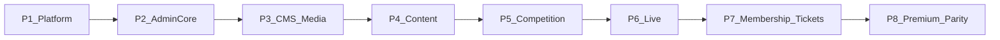

# FK Gračanica — Production Roadmap (Post-Scaffold)

## Current state vs production target

The scaffold phase ([CHECKLIST.md](.cursor/plans/fk-gracanica/CHECKLIST.md)) marked all 7 original phases complete, but [HANDOFF.md](.cursor/plans/fk-gracanica/HANDOFF.md) and codebase inspection show a **scaffold-plus-partial** reality:

| Layer | Done | Gap |
|-------|------|-----|
| **Backend** | Auth, settings, upload renditions, live scoring, ticketing/membership core, 30+ Prisma models, Socket.IO gateway | Thin DTO validation on many modules; no standardized pagination/filter; missing `GET /news/slug/:slug`; capacity/refund logic incomplete |
| **Frontend** | Auth, layouts, settings UI, news admin CRUD, live/commentator, 25 admin routes, 15 public routes | **22/25 admin pages are read-only tables** (e.g. [UsersPage.tsx](frontend/src/pages/admin/UsersPage.tsx)); **no in-app notifications UI**; homepage sections empty without seed; trophy `title` vs `name` mismatch |
| **Mobile** | Auth, 7 screens, Socket.IO live, notifications list | No QR renderer; no images; light-only theme; news fetches full list client-side |
| **Tests** | 4 unit + 6 e2e (auth, live, upload, ticketing, membership, health) | No e2e for admin CRUD workflows, content approval, league stats propagation |

This roadmap **does not re-scaffold**. It hardens modules in dependency order using the [NewsAdminFormSheet](frontend/src/pages/admin/NewsAdminFormSheet.tsx) pattern as the admin CRUD template.

**Plan artifacts:** extend [.cursor/plans/fk-gracanica/](.cursor/plans/fk-gracanica/) with `13_phase-platform.md` … `20_phase-premium.md`, update [CHECKLIST.md](.cursor/plans/fk-gracanica/CHECKLIST.md) with production items, and rotate [HANDOFF.md](.cursor/plans/fk-gracanica/HANDOFF.md) at every phase exit.

**Hard rules (every phase):**
- Files target **100–150 lines**; split into helpers before merging
- **No placeholders** — every endpoint/UI must be callable and testable
- Matrices required when touching: `live_center`, `ticketing`, `membership`, `rbac` ([.cursor/docs/matrices/](.cursor/docs/matrices/))
- i18n: BS default; new UI strings via `t()` keys (EN keys parallel, translations can lag)

---

## Phase 1 — Platform Foundation & Cross-Cutting Contracts

**LOCK THIS FIRST** — all later phases depend on shared patterns established here.

### Scope

| Stack | Modules |
|-------|---------|
| **Backend** | `common/` pagination + response helpers; `notifications` emit on key actions; `settings` realtime contract; `news` add `GET /news/slug/:slug`; RBAC guard audit on all controllers; `audit` on settings/notifications mutations |
| **Frontend** | In-app **notifications** (bell, dropdown/sheet, list page, mark-read, Socket `settings:changed` listener); shared `AdminFormSheet` + `usePaginatedQuery` hooks; error boundary on admin layout; fix trophy `name` field mapping |
| **Mobile** | `GET /news/slug/:slug`; shared `RemoteImage` component; notifications polish (unread badge on tab) |

### Context budget justification (~70%)

- **~18–22 files** touched: 4 backend common helpers, 2 notification endpoints polish, 1 news route, 6 frontend notification components/hooks, 2 mobile files, 3 test files, HANDOFF
- Single cross-cutting feature (notifications) + one API contract (pagination) — no full module CRUD yet
- Reuses existing [notifications.service.ts](backend/src/notifications/notifications.service.ts) and [realtime.gateway.ts](backend/src/realtime/realtime.gateway.ts) — no new Prisma models

### Production checklist

- [ ] `PaginatedQueryDto` + `paginate()` helper: `page`, `limit` (max 100), `sort`, `order`, `search`; consistent `{ data, meta: { total, page, limit } }` envelope
- [ ] All list endpoints used in P1 scope return paginated responses
- [ ] `GET /news/slug/:slug` — 404 if not `PUBLISHED`; slug uniqueness enforced at create
- [ ] Notifications: create on login (optional), settings change (admin), news approval (stub hook for P4); `PATCH /notifications/:id/read`, `PATCH /notifications/read-all`
- [ ] Frontend: notification bell in [AdminLayout.tsx](frontend/src/components/layout/AdminLayout.tsx) + [PublicLayout.tsx](frontend/src/components/layout/PublicLayout.tsx) for authenticated members; mobile sheet on `<lg`
- [ ] Socket: subscribe to `notification:new` (add event if missing); invalidate TanStack Query cache
- [ ] RBAC audit script/checklist: every mutating route has `@RequirePermissions`; document gaps fixed
- [ ] Trophy public page maps Prisma `name` field (fix `title` mismatch from HANDOFF §6)
- [ ] Unit tests: pagination helper, news slug lookup
- [ ] Integration/e2e: `notifications.e2e-spec.ts` — create → list → mark read
- [ ] All new files ≤150 lines

### Handoff exit criteria

`HANDOFF.md` must capture:
1. Pagination contract (DTO fields, response shape, example curl)
2. Notification event names + which actions trigger them
3. List of RBAC gaps found/fixed (permission keys)
4. New shared frontend primitives: `AdminFormSheet`, `usePaginatedQuery`, `NotificationBell` paths
5. Mobile `RemoteImage` + slug API usage
6. Test commands that pass for P1
7. Explicit **P2 entry point**: "Implement Users + Roles full CRUD using AdminFormSheet pattern"

---

## Phase 2 — Admin Core: Users, RBAC, Audit, Dashboard

### Scope

| Stack | Modules |
|-------|---------|
| **Backend** | `users`, `rbac` — full DTO validation (class-validator), soft-delete users, role assignment, permission seed sync; `audit` filtered list; `dashboard` KPI queries verified against real counts |
| **Frontend** | [UsersPage.tsx](frontend/src/pages/admin/UsersPage.tsx), [RolesPage.tsx](frontend/src/pages/admin/RolesPage.tsx), [AuditPage.tsx](frontend/src/pages/admin/AuditPage.tsx), [DashboardPage.tsx](frontend/src/pages/admin/DashboardPage.tsx) — full CRUD forms, permission matrix UI, audit filters (date, actor, action), KPI cards with loading/error states |
| **Mobile** | None (admin-only phase) |

### Context budget justification

- 4 admin pages × ~3 files each (page, form sheet, hook) = ~12 FE files
- Backend DTOs + 2 services + tests = ~8 files
- Fits ~70%: one domain (identity/admin), reuses P1 pagination + form patterns

### Production checklist

- [ ] Create user: email unique, password min 8, roleIds validated; bcrypt cost 10
- [ ] Update user: cannot demote last admin; soft-delete sets `deletedAt`
- [ ] Roles: assign/revoke permissions; prevent deleting system roles
- [ ] Audit: pagination + filters; immutable log (no delete endpoint)
- [ ] Dashboard KPIs: users, members, news published, matches, goals — each query indexed
- [ ] Writer/Moderator/Commentator roles enforced at API (not just seed)
- [ ] Update [rbac/MATRIX.md](.cursor/docs/matrices/rbac/MATRIX.md) + CHANGELOG
- [ ] e2e: `admin-users-rbac.e2e-spec.ts`

### Handoff exit criteria

- Permission matrix table (role × permission) reflecting DB seed
- Admin CRUD pattern doc (copy from News → Users)
- KPI query sources documented
- P3 entry: "Media folders + CMS blocks editor"

---

## Phase 3 — CMS, Media Library & Settings Hardening

### Scope

| Stack | Modules |
|-------|---------|
| **Backend** | `media` (folder tree, upload, replace, delete, search, tags); `cms` (block CRUD by key); `upload` validation (mime, max size, virus-scan hook stub → real rejection list) |
| **Frontend** | [MediaPage.tsx](frontend/src/pages/admin/MediaPage.tsx), [CmsPage.tsx](frontend/src/pages/admin/CmsPage.tsx), [SettingsPage.tsx](frontend/src/pages/admin/SettingsPage.tsx) — folder browser, drag-drop upload, image preview (thumb/medium/original), CMS JSON editor with schema per block key; homepage [Hero.tsx](frontend/src/pages/home/sections/Hero.tsx) reads live CMS |
| **Mobile** | `RemoteImage` applied to news list/detail |

### Context budget justification

- Media is self-contained (biggest P3 chunk); CMS + settings polish are smaller
- ~20 files; no competition/live logic yet

### Production checklist

- [ ] Media: folder CRUD, move asset, replace file (keep ID, regenerate renditions), delete orphan check
- [ ] Upload limits from settings keys (`upload.maxSizeMb`, `upload.allowedMime`)
- [ ] CMS blocks: `home.hero`, `home.cta`, `footer`, `contact` — validated JSON schemas (Zod)
- [ ] Settings: boolean→switch already done; add save confirmation for private scope; realtime refresh on change
- [ ] e2e: `media-upload.e2e-spec.ts` (extends existing upload test)
- [ ] Public homepage hero renders CMS + fallback when block missing

### Handoff exit criteria

- CMS block key registry (key → schema → used-by page)
- Media folder URL structure and rendition paths
- P4 entry: "Content modules: gallery, sponsors, trophies, news workflow"

---

## Phase 4 — Content Modules: News, Gallery, Sponsors, Trophies, Contact

### Scope

| Stack | Modules |
|-------|---------|
| **Backend** | `news` (workflow Draft→Pending→Published→Archived, categories, tags, comments); `gallery`, `sponsors`, `trophies`, `contact`, `newsletter` — full validation, approval permissions |
| **Frontend** | Admin CRUD for all above; public [GalleryListPage](frontend/src/pages/public/GalleryListPage.tsx) lightbox + lazy load; [SponsorsPage](frontend/src/pages/public/SponsorsPage.tsx) tier grouping; [TrophiesPage](frontend/src/pages/public/TrophiesPage.tsx) timeline; [ContactPage](frontend/src/pages/public/ContactPage.tsx) + admin inbox; homepage [Gallery](frontend/src/pages/home/sections/Gallery.tsx), [Sponsors](frontend/src/pages/home/sections/Sponsors.tsx) wired |
| **Mobile** | News images; gallery screen (new tab or stack route) |

### Context budget justification

- 5 related content modules sharing `ContentStatus` workflow
- ~25–30 files but repetitive patterns from P1–P3 reduce novelty

### Production checklist

- [ ] News: Writer creates → Pending; Moderator approves → Published; slug SEO fields; cover from media library
- [ ] Comments: members only; moderate/delete admin endpoints
- [ ] Gallery: album workflow, photo order, EXIF display if present
- [ ] Sponsors: tiers (General, Gold, Silver, Bronze, Partner)
- [ ] Trophies: link to competition/matches; gallery relation
- [ ] Contact: rate limit, email routing via settings (`contact.routingEmail`)
- [ ] Newsletter: double opt-in optional flag; unsubscribe
- [ ] e2e: `content-workflow.e2e-spec.ts`

### Handoff exit criteria

- ContentStatus workflow diagram
- Which permissions map to Writer vs Moderator actions
- P5 entry: "Players, clubs, competitions, matches, league table"

---

## Phase 5 — Competition Stack: Players, Clubs, League, Statistics

### Scope

| Stack | Modules |
|-------|---------|
| **Backend** | `players`, `clubs`, `competitions`, `matches`, `statistics` — season scoping, lineup, match result entry (non-live), stats aggregation **on approval** |
| **Frontend** | Admin CRUD all; [FirstTeamPage](frontend/src/pages/public/FirstTeamPage.tsx) formation (horizontal desktop / vertical mobile); [LeaguePage](frontend/src/pages/public/LeaguePage.tsx) table, form, top scorers; [MatchCenterPage](frontend/src/pages/public/MatchCenterPage.tsx); homepage [LeagueTable](frontend/src/pages/home/sections/LeagueTable.tsx), [FeaturedPlayers](frontend/src/pages/home/sections/FeaturedPlayers.tsx) |
| **Mobile** | League standings screen; match detail |

### Context budget justification

- Largest data model interactions but no Socket.IO complexity
- Split helpers: `formation.util.ts`, `standings.util.ts`, `player-stats.util.ts`
- ~30 files — upper bound of 70%; avoid live commentator UI here

### Production checklist

- [ ] Player profile: photo, stats auto-derived from approved matches only
- [ ] Formation editor: drag positions, save lineup per match
- [ ] Standings: points, GD, form string (W/D/L last 5)
- [ ] Match CRUD: clubs, season, round, status; manual result entry pre-live
- [ ] Statistics: `PlayerStatistics`, `TeamStatistics` recompute job on match approval
- [ ] Indexes on `matchId`, `seasonId`, `playerId`
- [ ] e2e: `league-standings.e2e-spec.ts`

### Handoff exit criteria

- Standings calculation rules documented
- Stats recompute trigger points
- P6 entry: "Live center production hardening"

---

## Phase 6 — Live Center Production

### Scope

| Stack | Modules |
|-------|---------|
| **Backend** | `live` — all event types from [aplikacijski-plan.md](aplikacijski-plan.md) §Live Centar; approval workflow → stats propagation; `matches` official report lock |
| **Frontend** | [CommentatorPage](frontend/src/pages/admin/CommentatorPage.tsx) all instant actions; [LiveMatchPage](frontend/src/pages/public/LiveMatchPage.tsx) scoreboard, timeline, stats; moderator approval UI; [MatchCenterPage](frontend/src/pages/public/MatchCenterPage.tsx) post-match |
| **Mobile** | [live/[id].tsx](mobile/app/(tabs)/live/[id].tsx) parity with web feed; reconnection UX |

### Context budget justification

- Focused on one critical module; matrix already exists ([live_center/MATRIX.md](.cursor/docs/matrices/live_center/MATRIX.md))
- Event type map + approval flow ~20 files

### Production checklist

- [ ] All event types: goal, OG, penalty, cards, sub, VAR, etc. — each updates score/state correctly
- [ ] Approval: moderator/admin publishes report → triggers P5 stats recompute
- [ ] YouTube embed URL from public settings; countdown when no stream
- [ ] Socket: reconnect, join/leave rooms, auth failure handling
- [ ] Update live_center MATRIX + CHANGELOG
- [ ] e2e: extend [live-center e2e](backend/test); `scripts/qa-live-commentator.mjs` still passes
- [ ] Load test note: room broadcast <100ms target on LAN

### Handoff exit criteria

- Event type → score impact table (from MATRIX)
- Approval state machine
- P7 entry: "Membership + ticketing production"

---

## Phase 7 — Membership & Ticketing Production

### Scope

| Stack | Modules |
|-------|---------|
| **Backend** | `membership`, `ticketing` — capacity limits, categories (VIP/child/season), refund requests, box-office confirmation, member ticket discounts; `Payment` remains **non-gateway** |
| **Frontend** | [MembershipAdminPage](frontend/src/pages/admin/MembershipAdminPage.tsx), [TicketingAdminPage](frontend/src/pages/admin/TicketingAdminPage.tsx); member-facing reserve flow on web; QR validation admin page |
| **Mobile** | QR code renderer (`react-native-qrcode-svg`); ticket QR display; scanner screen for staff (camera permission) |

### Context budget justification

- Two tightly coupled modules with existing matrices
- ~22 files; e2e already partially done — extend not rewrite

### Production checklist

- [ ] Stadium capacity from settings; auto-close sales
- [ ] Ticket lifecycle: RESERVED → PAID_AT_BOX_OFFICE → USED / CANCELLED
- [ ] Refund request + admin approve/deny
- [ ] Membership: card number, QR, renewal, benefits, discount on tickets
- [ ] Notifications on order confirmed, membership expiring
- [ ] Update [ticketing/MATRIX.md](.cursor/docs/matrices/ticketing/MATRIX.md), [membership/MATRIX.md](.cursor/docs/matrices/membership/MATRIX.md)
- [ ] e2e: extend `ticketing-qr`, `membership-card`

### Handoff exit criteria

- Ticket state machine diagram
- Payment stub boundaries (what is explicitly out of scope)
- P8 entry: "SEO, premium modules, PWA, security, full mobile parity"

---

## Phase 8 — Premium, SEO, Search, Security & Mobile Parity

### Scope

| Stack | Modules |
|-------|---------|
| **Backend** | `search` facets; `analytics`; sitemap/robots endpoints; `hall-of-fame`, `museum`, `club-timeline`; cache headers; `jobs` email sending (SMTP from settings) |
| **Frontend** | SEO [Seo.tsx](frontend/src/components/seo/Seo.tsx) + Schema.org; [SearchPage](frontend/src/pages/public/SearchPage.tsx) facets; Hall of Fame, Museum, Club timeline admin+public; PWA manifest; dark **system** theme; performance (code split, skeleton) |
| **Mobile** | Dark/light/system theme; push notification prep (`expo-notifications` stub + permission flow); full i18n key coverage; tab icons (vector) |

### Context budget justification

- Mostly polish and parallel features — no new core DB entities
- ~25 files; final security pass

### Production checklist

- [ ] `sitemap.xml`, `robots.txt`, canonical URLs, OG/Twitter meta per route
- [ ] Global search: news, players, clubs, matches, galleries, trophies with pagination
- [ ] Hall of Fame + Museum + Timeline: full CRUD + public premium layout
- [ ] PWA: installable, offline shell for public pages
- [ ] Caching: public API Cache-Control; Redis cache for standings/homepage
- [ ] Email jobs: contact form, newsletter, notification digests (feature-flagged)
- [ ] Security: helmet headers audit, throttler on auth/contact, CSRF where needed, upload audit
- [ ] WCAG spot-check on public pages
- [ ] Full e2e smoke suite in CI
- [ ] Mobile parity checklist 100% vs web member features

### Handoff exit criteria

- Production launch checklist (deploy, seed, monitoring)
- Known deferred items (online payment gateway, push production)
- Final CHECKLIST.md all production items ticked

---

## Phase dependency summary

| Phase | Focus | Est. files | Blocks |
|-------|-------|------------|--------|
| **P1** | Platform + notifications + contracts | ~20 | All |
| P2 | Admin users/RBAC/audit | ~20 | P3–P8 admin |
| P3 | Media + CMS | ~20 | P4 content |
| P4 | Content modules | ~28 | P5–P8 public |
| P5 | Competition + stats | ~30 | P6 live approval |
| P6 | Live center | ~22 | P7 match links |
| P7 | Membership + tickets | ~22 | P8 |
| P8 | Premium + parity | ~25 | Launch |

---

## Phase 1 — explicit lock (start here)

**Goal:** Establish production-grade shared infrastructure so Phases 2–8 are mechanical repetitions of proven patterns — not ad-hoc fixes.

**In scope for first execution session:**
1. Paginated API contract + apply to notifications, audit, users list
2. Full in-app notifications on web (backend already exists)
3. `GET /news/slug/:slug` + mobile consumes it
4. RBAC guard audit fixes
5. Trophy field bugfix
6. Shared `AdminFormSheet` / `usePaginatedQuery` extracted from news admin
7. Tests: pagination unit + notifications e2e
8. Update `HANDOFF.md` + create `13_phase-platform.md`

**Out of scope for P1:** User CRUD forms, media CMS, content workflows, live changes, ticketing — these are P2–P7.

**Success gate:** Admin sees notification bell with live updates; mobile opens news by slug; all P1 tests green; HANDOFF §7 points to P2.
