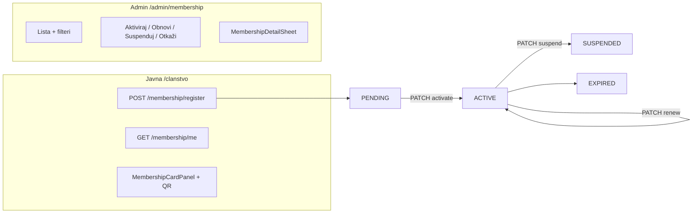

# Gate #13 — Članstvo (admin + javna stranica)

## Trenutno stanje

Backend modul je **gotov** ([`backend/src/membership/`](backend/src/membership/)): `register`, `me`, `findAll`, `activate`, `renew`, `suspend`, `cancel` + RBAC `membership.manage`.

Frontend ima **skelet** koji nije gate-ready:

| Područje | Problem |
|----------|---------|
| Admin | [`MembershipAdminPage.tsx`](frontend/src/pages/admin/MembershipAdminPage.tsx) čita `fullName`/`email` na rootu — API vraća `user.email` (nested) |
| Admin | Nema **Obnovi**, filtera po statusu, detalj sheet-a, bojanih badge-ova |
| Admin | Mutacije su u [`use-competition-admin.ts`](frontend/src/hooks/use-competition-admin.ts) (pogrešan modul) |
| Javna | [`MembershipPage.tsx`](frontend/src/pages/public/MembershipPage.tsx) samo šalje zahtjev — nema `GET /membership/me`, statusa ni kartice |
| Tipovi | Nema `Membership` tipa u [`frontend/src/types`](frontend/src/types) |
| QR | Mobile ima [`QrCodeView`](mobile/src/components/QrCodeView.tsx); web nema QR renderer |



---

## Faza 1 — Backend polish (minimalno)

**Fajl:** [`backend/src/membership/membership.service.ts`](backend/src/membership/membership.service.ts)

1. **`register`** — odbij ako korisnik već ima `PENDING` ili `ACTIVE` članstvo (`BadRequestException`).
2. **`findAll`** — uključi `user: { select: { id, email, firstName, lastName } }`; opcioni `@Query('status')` filter u controlleru.
3. **`resolveExpired`** — helper koji na čitanju (`findForUser`, `findAll`, `findOne`) postavlja `EXPIRED` kad je `endDate < now` i status je `ACTIVE` (usklađivanje s [MATRIX.md](.cursor/docs/matrices/membership/MATRIX.md)).

**Fajl:** [`backend/src/membership/membership.controller.ts`](backend/src/membership/membership.controller.ts) — `@Query('status')` na `findAll`.

**Test:** proširiti [`backend/test/membership-card.e2e-spec.ts`](backend/test/membership-card.e2e-spec.ts) — duplicate register → 400.

---

## Faza 2 — Frontend hooks + tipovi

Novi fajl **`frontend/src/hooks/use-membership.ts`** (~80 linija):

- `useMyMembership()` → `GET /membership/me`
- `useMemberships(status?)` → `GET /membership`
- `useMembershipDetail(id)` → `GET /membership/:id`
- `useActivateMembership`, `useRenewMembership`, `useSuspendMembership`, `useCancelMembership`
- Premjestiti mutacije iz `use-competition-admin.ts`

Novi tip u **`frontend/src/types/membership.ts`**:

```ts
export type MembershipStatus = 'PENDING' | 'ACTIVE' | 'SUSPENDED' | 'EXPIRED' | 'CANCELLED';
export interface MembershipRow { id; status; startDate?; endDate?; user?; card?; ... }
```

Helper **`frontend/src/lib/membership-status.ts`** — `membershipStatusVariant()` + BS labeli (kao `statusVariant` u News adminu).

---

## Faza 3 — Admin UI (gate pattern kao Ticketing)

Refaktor [`MembershipAdminPage.tsx`](frontend/src/pages/admin/MembershipAdminPage.tsx) po uzoru na [`TicketingAdminPage.tsx`](frontend/src/pages/admin/TicketingAdminPage.tsx):

- Filter chipovi: Sve | Na čekanju | Aktivna | Suspendovana | Istekla | Otkazana
- Kolone: Ime (`firstName lastName`), Email, Status (bojeni `Badge`), Datum isteka, Broj kartice
- Akcije po statusu:
  - `PENDING` → Aktiviraj
  - `ACTIVE` → Obnovi, Suspenduj, Otkaži
  - `SUSPENDED` → Aktiviraj, Otkaži
- `hasPermission(user, 'membership.manage')` za akcije (kao Sponsors)
- Klik na red → novi **`MembershipDetailSheet.tsx`** (email, datumi, kartica, QR, audit info)

**Ruta:** opciono omotati u `<PermissionRoute permission="membership.manage">` u [`App.tsx`](frontend/src/App.tsx) (sigurnosno; nav već filtrira).

---

## Faza 4 — Javna stranica `/clanstvo`

Refaktor [`MembershipPage.tsx`](frontend/src/pages/public/MembershipPage.tsx):

| Stanje korisnika | UI |
|------------------|-----|
| Nije prijavljen | CTA → login (postojeće) |
| Nema članstva | Dugme „Prijavi se za članstvo" |
| `PENDING` | Poruka „Zahtjev na čekanju — aktivacija na blagajni" |
| `ACTIVE` | **`MembershipCardPanel`** — broj kartice, važi do, QR |
| `SUSPENDED` / `EXPIRED` / `CANCELLED` | Informativna poruka + kontakt link |

Novi **`frontend/src/components/membership/MembershipQrCode.tsx`** — dodati dep `qrcode` (canvas → data URL, bez React wrappera; ~40 linija).

Nakon registracije: `invalidateQueries(['membership','me'])` umjesto samo lokalnog `done` state.

---

## Faza 5 — Gate + dokumentacija

1. **Gate checklist** (iz [03_track-admin-modules.md](.cursor/plans/fk-gracanica/21_web-complete/03_track-admin-modules.md)):
   - [x] Workflow complete (register → activate → renew/suspend/cancel)
   - [x] Filteri + status badge
   - [x] RBAC backend + frontend
   - [x] Javni prikaz usklađen (status + kartica)
   - [x] E2E smoke

2. Ažurirati:
   - [`GATE_LOG.md`](.cursor/plans/fk-gracanica/21_web-complete/GATE_LOG.md) → `READY_FOR_REVIEW`
   - [`membership/MATRIX.md`](.cursor/docs/matrices/membership/MATRIX.md) + CHANGELOG (EXPIRED lazy resolve, admin UI)
   - [`21_web-complete/HANDOFF.md`](.cursor/plans/fk-gracanica/21_web-complete/HANDOFF.md) — ispraviti „nema admin UI"

3. **Ručni smoke test** (prije APPROVED):
   - Registracija kao običan user → PENDING
   - Admin aktivacija → kartica + QR
   - Javna stranica prikazuje karticu
   - Admin obnova → produžen `endDate`
   - Suspend / cancel

---

## Fajlovi (procjena diff-a)

| Akcija | Fajl |
|--------|------|
| Edit | `membership.service.ts`, `membership.controller.ts` |
| Edit | `membership-card.e2e-spec.ts` |
| New | `frontend/src/types/membership.ts` |
| New | `frontend/src/hooks/use-membership.ts` |
| New | `frontend/src/lib/membership-status.ts` |
| New | `frontend/src/components/membership/MembershipQrCode.tsx` |
| New | `frontend/src/components/membership/MembershipCardPanel.tsx` |
| New | `frontend/src/pages/admin/MembershipDetailSheet.tsx` |
| Edit | `MembershipAdminPage.tsx`, `MembershipPage.tsx` |
| Edit | `hooks/index.ts`, `use-competition-admin.ts` (ukloniti membership mutacije) |
| Edit | `frontend/package.json` (+ `qrcode` + `@types/qrcode`) |
| Edit | GATE_LOG, MATRIX, HANDOFF |

Svi novi fajlovi ispod **200 linija** (pravilo repoa).

---

## Izvan scope-a (ne blokira gate)

- Server-side cron za EXPIRED (lazy resolve na read je dovoljan za v1)
- Paginacija admin liste (mali volumen; filteri client-side kao Ticketing)
- `feature.membership` toggle na javnoj ruti (PRIVATE setting; admin-only za sada)
- Mobile — na pauzi prema HANDOFF-u
