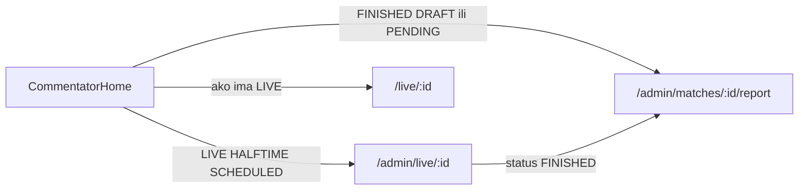

# Komentator dashboard — maksimalni polish

Web-only. Mobile `/staff/commentator` se ne dira (P2 u track 34). Gate scan ostaje uncommitted kako HANDOFF kaže.

Trenutno je [CommentatorHome.tsx](frontend/src/pages/admin/homes/CommentatorHome.tsx) lista + 3 KPI-a bez href-a. CTA **Desk** uvijek ide na `/admin/live/:id` i za FINISHED utakmice (pravi editor je `/admin/matches/:id/report`). KPI „Izvještaji / Za predaju” broji `PENDING_APPROVAL` (već predato), a nacrti (`FINISHED` + `DRAFT`) nisu na desk listi.

## 1. Desk helperi — [commentator-desk.ts](frontend/src/pages/admin/homes/commentator-desk.ts)

Proširiti pure helper (ostaje < 150 linija):

- `isLiveDesk` = `LIVE | HALFTIME`
- `needsReport` = `FINISHED` + `DRAFT` (komentator još predaje)
- `awaitingApproval` = `FINISHED` + `PENDING_APPROVAL`
- `isTodayScheduled` po lokalnom danu
- `deskHref(match)`: live/scheduled → `/admin/live/:id`, finished report → `/admin/matches/:id/report`
- `pickCommentatorDeskMatches`: live, danas SCHEDULED, ostali upcoming (limit 8, postojeći 3h prozor), pa `needsReport` pa `awaitingApproval`
- `groupDeskMatches` za sekcije: Uživo / Danas / Predstojeće / Izvještaji
- `primaryDeskMatch`: prvi live, inače prvi danas, inače prvi upcoming

Novi spec: `frontend/src/pages/admin/homes/commentator-desk.spec.ts` (href, grupisanje, nacrti vs pending).

## 2. Home — match-day tabla

[CommentatorHome.tsx](frontend/src/pages/admin/homes/CommentatorHome.tsx) ostaje tanak orkestrator (~100 linija). Lista/hero u nove fajlove da ne pukne 200-limit.

**KPI (4 kartice, `HomeKpiGrid` href-ovi):** Uživo · Danas · Nacrti izvještaja · Čeka odobrenje. Brojke iz helpera, ne „sve SCHEDULED”.

**Live hero** (samo ako postoji live/pauza): [ClubCrest](frontend/src/components/public/clubs/ClubCrest.tsx) + rezultat + `matchStatusTone` pulse + CTA Desk + Javni live. Socket: `useMatchRealtime(live[0].id)` da se rezultat osvježava na `/admin`.

**Lista** po grupama, red: grbovi, naslov, status badge, kickoff, CTA „Desk” ili „Izvještaj”. Skeleton redovi + error/retry kao [AdminHome](frontend/src/pages/admin/homes/AdminHome.tsx) + prazan copy bez kalendara.

**Brze akcije:** Otvori desk (`deskHref(primary)`), Javni live samo ako ima LIVE, Izvještaj ako ima nacrt. Ukloniti fallback na `/admin/competitions` kad nema utakmice.

Novi fajlovi (svi < 150):

- `frontend/src/pages/admin/homes/CommentatorLiveHero.tsx`
- `frontend/src/pages/admin/homes/CommentatorDeskList.tsx`

Tokeni: `border-[var(--border-subtle)]`, ne `slate-200`.

## 3. Desk chrome — [CommentatorPage.tsx](frontend/src/pages/admin/CommentatorPage.tsx) + [MatchReportPage.tsx](frontend/src/pages/admin/MatchReportPage.tsx)

Isti ops header, extract `CommentatorDeskHeader.tsx`:

- FINISHED na `/admin/live/:id` → `<Navigate>` na report (simetrično postojećem report → live)
- Grbovi + rezultat + takmičenje/kolo/stadion + javni link
- Socket badge: mali hook `useRealtimeConnected()` (`socket.connected` + `connect`/`disconnect`) — nedostaje danas
- Loading: stacked Skeleton; not-found + error/retry
- Clock bar: isti header ne duplirati ime utakmice; ostaje minuta + akcije sata

[CommentatorClockBar.tsx](frontend/src/pages/admin/commentator/CommentatorClockBar.tsx) linije 28–51: minuta + period + stream + badge; score ostaje jer je to ops semafor.

## 4. Ops na desku (bez novih endpointa)

- [CommentatorTeamBoard.tsx](frontend/src/pages/admin/commentator/CommentatorTeamBoard.tsx) linije 86–97: ukloniti `GOAL` bez `playerId` (matrica: klub akcije zahtijevaju igrača). Svi quick eventi disabled dok nije izabran igrač.
- [CommentatorControls.tsx](frontend/src/pages/admin/commentator/CommentatorControls.tsx) linije 42–54: dnevnik uvijek otvoren, najnoviji gore. Extract `CommentatorEventLog.tsx` (shared sa report, delete samo u reportMode).
- [CommentatorClockActions.tsx](frontend/src/pages/admin/commentator/CommentatorClockActions.tsx) je **207 linija** (limit 200). Prije bilo kakvog dodavanja: extract `clock-actions.ts` (`buildClockActions(match)`). „Završi” / „Završi penale” kroz postojeći `useConfirm` (danger).

Ne dirati backend live API, socket payload, ni mobile.

## 5. Matrica + HANDOFF

- [live_center MATRIX.md](.cursor/docs/matrices/live_center/MATRIX.md) + [CHANGELOG.md](.cursor/docs/matrices/live_center/CHANGELOG.md): desk rute, KPI nacrti vs pending, GOAL uvijek s igračem.
- [36 HANDOFF.md](.cursor/plans/fk-gracanica/36_ops-ticketing-live/HANDOFF.md): next step = ovaj polish; gate scan i dalje uncommitted.

## Van scopea

- Mobile komentator, showcase intercept, commit/push, Cursor `*.plan.md` fajlovi.

## Test

- `npx vitest run src/pages/admin/homes/commentator-desk.spec.ts` (frontend)
- Ručno: `/admin` kao komentator — live hero, grupisana lista, Desk vs Izvještaj, socket badge na desku, gol bez igrača disabled, confirm na Završi.
