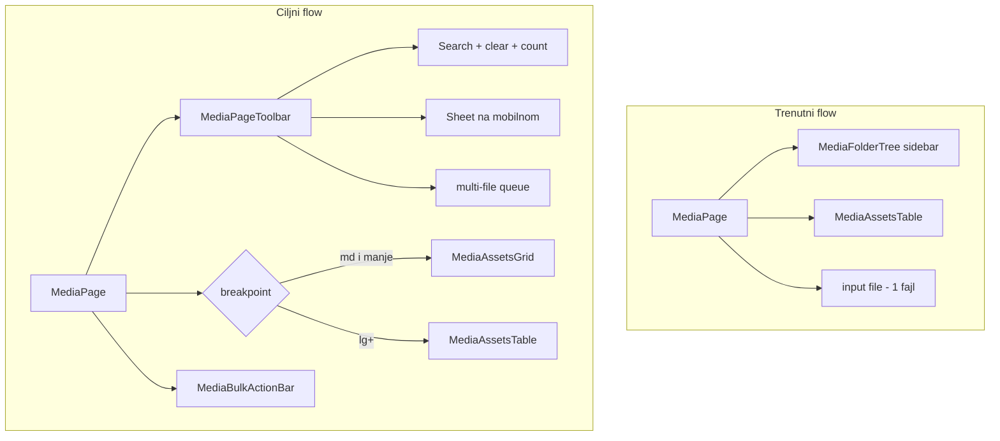

# Plan: Dashboard Mediji — responsive, pretraga, multi-upload i bulk select

## Trenutno stanje

Glavna stranica: [`frontend/src/pages/admin/MediaPage.tsx`](frontend/src/pages/admin/MediaPage.tsx)

| Oblast | Stanje |
|--------|--------|
| Layout | `lg:grid-cols-[220px_1fr]` — ispod `lg` folder i tabela se stackaju bez mobilne optimizacije |
| Prikaz asseta | Samo [`MediaAssetsTable.tsx`](frontend/src/pages/admin/MediaAssetsTable.tsx) (horizontalni scroll, 4 dugmeta po redu) |
| Upload | Skriveni `<input type="file">` bez `multiple`, uzima samo `files[0]` |
| Pretraga | Debounce 300ms + global search (folderId se isključi) — backend već podržava `search` kroz [`PaginatedQueryDto`](backend/src/common/dto/paginated-query.dto.ts) i [`media.service.ts` L50-56](backend/src/media/media.service.ts) |
| Referenca | [`MediaPickerDialog.tsx`](frontend/src/components/admin/MediaPickerDialog.tsx) — responsive grid, folder sidebar, broj rezultata |



---

## Faza 1 — Toolbar, pretraga i desktop spacing

**Cilj:** Ujednačen header kao na drugim admin stranicama (npr. [`ContactAdminPage.tsx` L60-70](frontend/src/pages/admin/ContactAdminPage.tsx)), bolji UX pretrage.

**Novi fajl:** `frontend/src/pages/admin/media/MediaPageToolbar.tsx` (~80 linija)

- Jedan red: pretraga (puna širina na mobilnom, `max-w-md` na `lg+`) + akcije desno
- Ikona pretrage + dugme za brisanje upita (`X`) kad `search` nije prazan
- Kontekstualni hint ispod (postojeća logika iz `MediaPage`, ali precizniji empty state):
  - tokom pretrage: `N pronađenih medija` iz `data.meta.total` (kao u `MediaPickerDialog`)
  - van pretrage: mapa / „Svi mediji"
- Na `lg+`: `border-b border-[var(--border-subtle)] px-4 py-3` umjesto razbacanog `px-4 pb-2`
- Dugme **Upload** + na mobilnom kompaktnija varijanta (`size="sm"`, kraći label)

**Ispravke pretrage (bez backend promjena):**
- Empty state u tabeli/gridu: tokom pretrage → „Nema rezultata za „…"" umjesto „Nema medija u ovoj mapi"
- Reset `page` na 1 pri promjeni pretrage (već postoji) + **clear selection** pri promjeni pretrage/foldera
- Opcionalno: `useEffect` koji resetuje `page` kad `debouncedSearch` postane prazan

---

## Faza 2 — Mobilni responsive layout

**Cilj:** Kompaktan prikaz i jednostavniji upload sa telefona.

### 2a. Folder picker na mobilnom

**Novi fajl:** `frontend/src/pages/admin/media/MediaFolderSheet.tsx` (~60 linija)

- Koristi postojeći [`Sheet`](frontend/src/components/ui/sheet.tsx) (isti pattern kao `AdminLayout`)
- U Sheetu renderuje postojeći [`MediaFolderTree`](frontend/src/components/admin/MediaFolderTree.tsx) — bez dupliranja logike stabla
- Na `< lg`: umjesto sidebar-a, chip/dugme „Mapa: {ime}" koje otvara Sheet; zatvaranje nakon odabira mape
- Na `lg+`: zadržati trenutni sidebar (`border-r`, fiksna širina 220px)

### 2b. Kompaktan prikaz asseta

**Novi fajl:** `frontend/src/pages/admin/media/MediaAssetsGrid.tsx` (~100 linija)

- Prikaz ispod `lg` (tabela sakrivena `hidden lg:block`)
- Grid: `grid-cols-2 sm:grid-cols-3 gap-2 p-3` — inspiracija iz `MediaPickerDialog` L119
- Kartica: thumbnail + skraćeni filename + veličina; akcije kao 2–3 icon-only dugmeta ili tap → `MediaAssetFormSheet`
- U selection modu: checkbox overlay na kartici (vidi Faza 4)

### 2c. Upload UX na mobilnom

**Novi fajl:** `frontend/src/pages/admin/media/MediaUploadZone.tsx` (~70 linija)

- Skriveni `<input type="file" accept="image/*" multiple>` — **bez** `capture` (OS picker nudi i galeriju i kameru)
- Na `< lg`: vidljiva zona „Dodaj slike" (dashed border, min-h 44px touch target) koja triggera input
- Na `lg+`: opcionalno ista zona ispod toolbara ili samo dugme u toolbaru
- Disabled + jasan tooltip kad nema odabrane mape

**Refaktor:** [`MediaPage.tsx`](frontend/src/pages/admin/MediaPage.tsx) ostaje orchestrator (~120 linija), delegira u nove module.

---

## Faza 3 — Multi-file upload queue

**Cilj:** Odabir više fajlova sa uređaja i redom upload u aktivnu mapu.

**Novi fajl:** `frontend/src/hooks/use-media-upload-queue.ts` (~90 linija)

```typescript
// Suština: sekvencijalni pozivi postojećeg POST /media/upload
type QueueItem = { id: string; file: File; status: 'pending' | 'uploading' | 'done' | 'error' };
```

- `enqueue(files: FileList | File[], folderId: string)` — filtrira non-image, dodaje u queue
- Sekvencijalno poziva postojeći `useUploadMedia` mutation (backend bez promjena)
- `invalidateQueries` jednom nakon završetka cijelog batcha
- Stanje: `{ total, done, failed, isRunning }` za progress bar u toolbaru
- Greške po fajlu: nastavi sa sljedećim, prikaži sažetak „3/5 uspješno, 2 neuspješno"

**UI:** kompaktan progress ispod upload zone / u toolbaru dok traje upload.

---

## Faza 4 — Bulk select postojećih medija

**Cilj:** Označavanje više asseta u biblioteci za grupne akcije.

**Novi fajl:** `frontend/src/hooks/use-media-selection.ts` (~50 linija)

- `selectedIds: Set<string>`, `toggle(id)`, `selectAll(visibleIds)`, `clear()`
- `selectionMode: boolean` toggle u toolbaru

**Novi fajl:** `frontend/src/pages/admin/media/MediaBulkActionBar.tsx` (~80 linija)

- Sticky bar na dnu ekrana (`fixed bottom-0` na mobilnom, inline na desktopu) kad `selectedIds.size > 0`
- Akcije:
  - **Obriši** — confirm sa brojem; sekvencijalno `DELETE /media/assets/:id` (postojeći hook)
  - **Premjesti u mapu** — native `<select>` mapa + „Primijeni"; sekvencijalno `PATCH` sa `folderId` (postojeći `useUpdateMediaAsset`)
  - **Poništi odabir**
- „Odaberi sve na stranici" u toolbaru kad je selection mode aktivan

**Izmjene postojećih komponenti:**
- [`MediaAssetsTable.tsx`](frontend/src/pages/admin/MediaAssetsTable.tsx): opcionalna checkbox kolona + kompaktnije akcije na `lg+` (`flex gap-1`, manji padding `p-3`)
- `MediaAssetsGrid`: checkbox overlay u selection modu

Nema novih backend endpointa u prvoj iteraciji; za >20 stavki korisnik mijenja stranicu (pagination ostaje).

---

## Faza 5 — Desktop spacing polish

- Grid layout: `lg:grid-cols-[minmax(200px,240px)_1fr] gap-0`
- Tabela: smanjiti cell padding `p-4` → `p-3` samo u media kontekstu (prop na `AdminDataTable` ili lokalni wrapper — **ne** globalna promjena `AdminPageShell`)
- Toolbar i folder sidebar vertikalno poravnati (`items-start`)
- Paginacija: zadržati [`AdminPagination`](frontend/src/components/admin/AdminPagination.tsx), dodati `pb-safe` na mobilnom zbog sticky bulk bara

---

## Granice i odluke

| Tema | Odluka |
|------|--------|
| Backend | Bez novih ruta; batch = sekvencijalni pozivi |
| File limit | Svi novi fajlovi < 200 linija; `MediaPage.tsx` ostaje orchestrator |
| Bulk copy URL | Izvan scope-a (samo delete + move) |
| Drag-and-drop | Opcionalno samo na `md+` u `MediaUploadZone` ako stane u budžet |

---

## Test plan

| Viewport | Provjera |
|----------|----------|
| 375px | Folder Sheet, 2-col grid, upload zona, multi-file iz galerije, progress, bulk bar ne prekriva paginaciju |
| 768px | 3-col grid, toolbar wrap |
| 1280px | Sidebar + tabela, pretraga sa brojem rezultata, spacing, selection u tabeli |
| Funkcionalno | Upload 5 slika u mapu; bulk select 3 → premjesti; bulk delete sa confirm; pretraga po tagu/filename; prazna pretraga resetuje listu |
