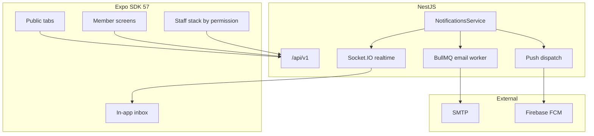

# 26 — Mobile Full Parity (SDK 57 + Roles + Notifications)

## Odluke (zaključano)

- **Opseg admina:** mobile-ops — svi role workflowi na telefonu; **CMS page builder / heavy builderi samo na webu**
- **Stack:** Expo **SDK 57** (RN 0.86), `expo-router`, isti `/api/v1` + Socket.IO
- **Push:** `expo-notifications` + **FCM** credentials preko EAS/Firebase (ne raw `@react-native-firebase`)
- **Email:** Nodemailer worker na postojećem BullMQ `email` queue (`[backend/src/jobs/jobs.module.ts](backend/src/jobs/jobs.module.ts)`) + SMTP settings
- **Uloga „User”:** mapira se na sistemsku ulogu **Član**
- **Baza plana (izvršenje):** `.cursor/plans/fk-gracanica/26_mobile-full-parity/` (`00_overview.md`, `01_phase-*.md`, `CHECKLIST.md`, `CHANGELOG.md`, `HANDOFF.md`) + matrica `.cursor/docs/matrices/mobile-parity/`

## Polazna tačka

Postojeći `[mobile/](mobile/)` (v1 CLOSED, Expo ~56): Guest Home/News/Live + Član Membership/Tickets/In-app notif. Auth/API/realtime već rade (`[mobile/src/lib/api.ts](mobile/src/lib/api.ts)`, `[auth.tsx](mobile/src/lib/auth.tsx)`, `[realtime.ts](mobile/src/lib/realtime.ts)`).

Web design tokeni: primary `#1E3A8A`, accent `#60A5FA`, Inter + Plus Jakarta Sans — mobile theme već u `[mobile/src/lib/theme.ts](mobile/src/lib/theme.ts)`; uskladiti dark surface s web `#050a14` / `#0a1525` gdje treba vizuelni match.

---

## Faza 1 — Foundation (SDK 57 + navigacija + dizajn)

**Cilj:** stabilan SDK 57 shell + IA za javno / član / staff.

- Upgrade: `npx expo install expo@latest --fix` u `mobile/`; update `[AGENTS.md](mobile/AGENTS.md)` na v57 docs; plugins u `[app.json](mobile/app.json)` (`expo-notifications`, `expo-device`, `expo-image`, …)
- Navigacija:
  - Public tabs: Home, Vijesti, Tim/Liga (More), Live, Profil/More
  - Auth stack: login (postojeći)
  - **Staff area** (`app/staff/…`): ulaz samo ako `permissions[]` sadrži barem jedan staff key; entry iz Profila („Radni prostor”)
  - Permission gate helper: `hasPermission(user, key)` / `RequirePermission`
- Dizajn: dijeljeni primitives (`Screen`, `SectionHeader`, `ListRow`, `PrimaryButton`, `Empty/Loading`) usklađeni s web public identity; light/dark/system ostaje
- Module flags: proširiti `[use-module-flags.ts](mobile/src/hooks/use-module-flags.ts)` na sve public module keys

**Van scopea faze:** novi feature ekrani (samo scaffold ruta gdje treba)

---

## Faza 2 — Public content parity (Guest)

**Cilj:** sve javne web module ekrane (read), bez admin CRUD.

| Modul                                       | Mobilni ekrani                                   | API                                                        |
| ------------------------------------------- | ------------------------------------------------ | ---------------------------------------------------------- |
| Vijesti                                     | list + detail (postoji)                          | `/news/published`, slug                                    |
| Galerija                                    | albumi + album detail                            | `/gallery`                                                 |
| Tim / klub                                  | first team, club, player                         | `/clubs/own`, `/clubs/public/:slug`, `/players/:id/public` |
| Liga                                        | standings, fixtures, match center                | `/statistics`, `/matches`                                  |
| Live                                        | list + detail (postoji)                          | live + socket                                              |
| Sponzori / Trofeji / Timeline / HoF / Muzej | list(+detail)                                    | odgovarajući public GET                                    |
| Kontakt / Newsletter / Pretraga             | forme + search                                   | `/contact`, `/newsletter`, `/search`                       |
| CMS stranice                                | **read-only** renderer po slug-u (bez builder-a) | `GET /cms/pages/:slug`                                     |
| Članstvo / Ulaznice                         | postojeće + polish                               | membership/ticketing public                                |

Responsive UX: sheet/drawer umjesto teških modala; bez horizontalnog overflowa.

---

## Faza 3 — Notifikacijski sistem (in-app + email + push)

**Cilj:** jedan `NotificationsService.create()` fan-out na 3 kanala.

### Backend

1. **Prisma:** `PushDevice` model (`id`, `userId`, `expoPushToken` unique, `platform`, `updatedAt`) + migration
2. **API:**
  - `POST /notifications/devices` — register Expo push token (JWT)
  - `DELETE /notifications/devices/:token` — unregister
  - (postojeći) list / read / read-all
3. **Email kanal:** implementirati worker u `JobsService` (Nodemailer); settings: proširiti registry (`smtp.user`, `smtp.pass` secret, `smtp.from`, `smtp.secure`) uz postojeće `smtp.host`/`smtp.port`
4. **Push kanal:** Expo Push API (ili FCM HTTP v1 preko Expo) — šalje se kad `create()`; tipovi događaja: live gol/status, ticket/membership, news approve, staff pending
5. **Preferences (minimalno):** settings ili polja na useru — `notify.inApp`, `notify.email`, `notify.push` (default true); poštovati pri fan-outu
6. **Realtime:** zadržati `notification:new` na auth socketu

### Mobile

- `expo-notifications` + permission prompt nakon logina
- Register token → BE; unregister na logout
- Inbox (postojeći tab) + OS push tap → deep link (`fkgracanica://…`)
- Badge sync preko postojećeg `[use-unread-notifications](mobile/src/hooks/use-unread-notifications.ts)`

### Firebase / EAS

- Firebase project + FCM Android credentials + APNs key
- EAS secrets / `eas.json` preview+production profiles; `google-services.json` / APNs via EAS (ne commitati secrete)
- Dokumentovati setup u plan `HANDOFF.md` (koraci, bez tajni)

---

## Faza 4 — Staff ops po rolama

**IA:** `app/staff/_layout.tsx` + hub ekran koji prikazuje kartice po `permissions[]`.

| Uloga             | Mobilni workflowi                                                                                                                                                                                                                   | Web ekvivalent (ops)                  | Isključeno (web-only)                                                                                            |
| ----------------- | ----------------------------------------------------------------------------------------------------------------------------------------------------------------------------------------------------------------------------------- | ------------------------------------- | ---------------------------------------------------------------------------------------------------------------- |
| **Writer**        | Novosti: create/edit → PENDING; Galerija: upload album → PENDING                                                                                                                                                                    | `/admin/news`, gallery submit         | —                                                                                                                |
| **Komentator**    | Live desk: feed, add event/comment, phase controls                                                                                                                                                                                  | `/admin/live/:id`, match report draft | —                                                                                                                |
| **Moderator**     | Approve news/gallery/live report; pending live lista                                                                                                                                                                                | approve screens                       | —                                                                                                                |
| **Administrator** | Dashboard KPI; Users list/create/roles; Settings toggles (boolean/number/string); Ticketing validate QR (kamera); Membership admin list/status; Media **upload + pick** (ne full library reorganize); Contact/Newsletter inbox read | `/admin/`* ops                        | CMS page builder, visual season hub complexity ako ne stane u ≤200 linija/ekran — tada split helpers, ne builder |
| **Član**          | Profil, članstvo, ulaznice, notif (već)                                                                                                                                                                                             | public member                         | —                                                                                                                |
| **Guest**         | Public read (Faza 2)                                                                                                                                                                                                                | public                                | —                                                                                                                |

Guardovi: isti permission keys kao BE (`news.submit`, `news.approve`, `live.manage`, `live.approve`, `settings.read`, `users.read`, `ticketing.manage`, …) iz `[permissions.ts](backend/src/common/constants/permissions.ts)`.

QR validate: `expo-camera` / barcode scanning → `POST` ticketing validate endpoint.

Upload: postojeći `POST /upload` + multipart.

---

## Faza 5 — Polish, EAS, matrice, ship

- i18n BS default + EN ključevi za nove ekrane
- Empty/loading/error konzistentno; reduced-motion gdje ima animacija
- `[PREVIEW_SMOKE.md](mobile/PREVIEW_SMOKE.md)` proširiti: guest / član / writer / komentator / moderator / admin smoke
- EAS preview build (Android prvo); store submit **opciono** na eksplicitni zahtjev
- Matrica: `.cursor/docs/matrices/mobile-parity/MATRIX.md` + `CHANGELOG.md` (ekran × uloga × API)
- Ažurirati plan `CHECKLIST` / `HANDOFF`

---

## Pravila tokom implementacije

- Fajlovi ≤200 linija (config do 400); split u helpers
- Plan-then-execute po fazi; ne dirati BE/FE bez dokazanog gapa (Faza 3 je namjerni BE gap)
- Bez commitovanja `.env`, Firebase JSON, SMTP pass
- Realtime ostaje Socket.IO (live + notification)

## Redoslijed izvršenja

1. Kreirati `.cursor/plans/fk-gracanica/26_mobile-full-parity/` dokumentaciju
2. Faza 1 → 2 → 3 → 4 → 5 (gate: checklist po fazi prije sljedeće)
3. Commit samo na eksplicitni zahtjev korisnika
