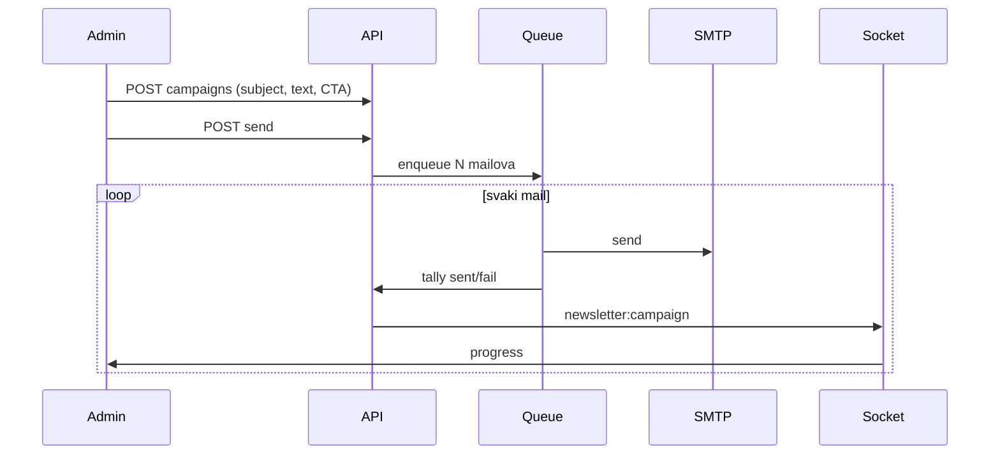

# Newsletter: template, klik-editor, Socket.IO brojke

Kategorije / grupe / pojedinačni odabir **nisu u ovom krugu** (zaključano). Slanje ostaje na sve aktivne pretplatnike.

## Danas (rupa)

- Editor je textarea „HTML tijelo” u `[NewsletterCampaignPanel.tsx](frontend/src/components/newsletter/NewsletterCampaignPanel.tsx)`.
- Brojke (`sentCount` / `targetCount` / `failCount`) se ažuriraju u `[newsletter-campaign-tally.ts](backend/src/newsletter/newsletter-campaign-tally.ts)` ali admin vidi samo na refetch — nema socket eventa.
- `[wrapEmailHtml](backend/src/jobs/email-templates.ts)` je tanak transactional wrap, nije newsletter layout.

## 1. Brendirani template (samo tekst u editoru)

Novi util `[backend/src/newsletter/newsletter-email.template.ts](backend/src/newsletter/newsletter-email.template.ts)` (čist HTML string, escape):

- Header: `club.name` + `club.crestUrl` iz settings
- Naslov kampanje, paragrafi iz `textBody` (newline → `
`)
- Opciono CTA dugme (`ctaLabel` + `ctaUrl`) ako je uključeno
- Footer: „FK Gračanica” + unsubscribe link (postojeći `[withUnsubscribeFooter](backend/src/newsletter/newsletter-campaign.util.ts)` uvući u template)

Send više ne šalje sirovi admin HTML. `htmlBody` u DB ostaje **snapshot** rendera (historija), `textBody` je izvor.

Migracija (sitna): na `NewsletterCampaign` dodati opcione `ctaLabel`, `ctaUrl` (String?).

DTO create: `subject`, `textBody`, opciono CTA — **bez** `htmlBody` od klijenta.

`POST /newsletter/campaigns/preview` → `{ html }` (isti renderer, dummy unsubscribe) za iframe.

## 2. Klik-editor (ne HTML)

Razdvojiti panel (≤200 linija):

- `[NewsletterCampaignComposer.tsx](frontend/src/components/newsletter/NewsletterCampaignComposer.tsx)`: Input naslov, Textarea tekst, **Switch** „Dugme u mailu” → Input label + URL
- Pregled: iframe `srcDoc` iz preview API (ne kucani HTML)
- Tablica ostaje u panelu; progress bar dok je `SENDING`

Nema WYSIWYG / custom HTML. Formatiranje = novi red = novi paragraf.

## 3. Socket.IO progress

Backend:

- `[RealtimeGateway](backend/src/realtime/realtime.gateway.ts)`: `newsletter:join` / `leave` → room `newsletter` (samo ako `client.data.userId`)
- `emitNewsletterCampaign({ id, status, sentCount, failCount, targetCount })`
- `[tallyCampaignEmail](backend/src/newsletter/newsletter-campaign-tally.ts)` vraća snapshot; `[JobsService](backend/src/jobs/jobs.module.ts)` emit nakon svakog maila (`JobsModule` importa `RealtimeModule`)

Frontend:

- Hook `useNewsletterCampaignRealtime` (isti pattern kao `[useNotificationRealtime](frontend/src/hooks/use-notifications.ts)` + `[getRealtimeSocket](frontend/src/lib/realtime.ts)`)
- Na event: patch React Query `['newsletter', 'campaigns']`
- UI: `poslano / cilj`, fail, **na čekanju** = `targetCount - sentCount - failCount`, badge statusa

## 4. Testovi + docs + Docker

- Spec: template escape + paragrafi; tally i dalje `campaignFinalStatus`
- Matrica `[newsletter/MATRIX.md](.cursor/docs/matrices/newsletter/MATRIX.md)` + CHANGELOG
- Katalog `newsletter-campaigns` summary rečenica (i dalje 100 ready)
- `./scripts/docker-prod-build.sh && docker compose up -d`

## Van opsega

- Newsletter kategorije, segmenti, ručni odabir emailova
- Mailchimp / drugi ESP
- Promjena `newsletter.blastEnabled` defaulta (ostaje off dok klub ne uključi)
