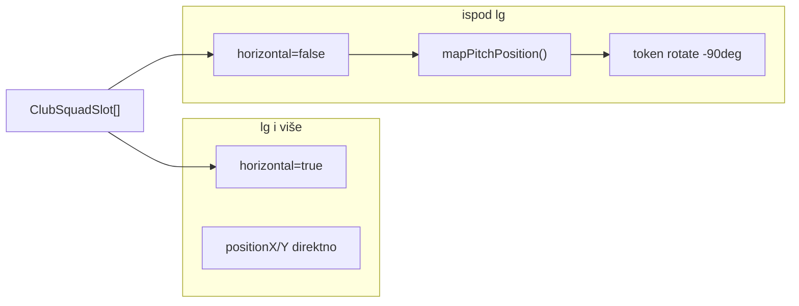
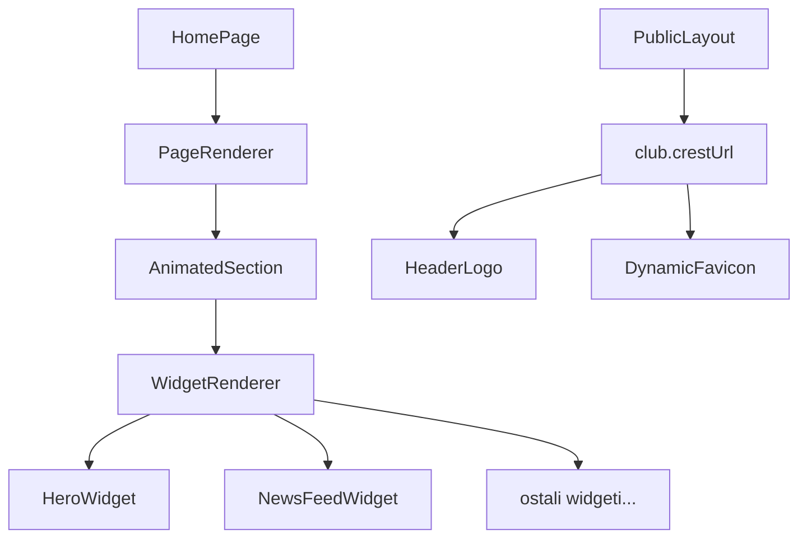

# Responsive + Premium Web Redizajn

## Kontekst (trenutno stanje)

- **20 javnih stranica** pod [`PublicLayout`](frontend/src/components/layout/PublicLayout.tsx) — većina koristi `mx-auto max-w-6xl px-4`, breakpoint `lg` (1024px) za nav drawer.
- **Skica**: [`FormationPitch`](frontend/src/components/public/clubs/FormationPitch.tsx) podržava `horizontal` prop; samo [`FirstTeamPage`](frontend/src/pages/public/FirstTeamPage.tsx) mijenja orijentaciju na `< lg`. [`ClubPublicPage`](frontend/src/pages/public/ClubPublicPage.tsx) i [`ClubPublicSections`](frontend/src/components/public/clubs/ClubPublicSections.tsx) uvijek koriste horizontalnu skicu — **bug na malim ekranima**.
- **Timeline**: [`ClubTimelineRail`](frontend/src/components/public/timeline/ClubTimelineRail.tsx) — vertikalna linija + tačke i na mobilnom; korisnik traži samo kartice sa scroll-snap.
- **Logo/favicon**: header je tekst "FK Gračanica"; favicon je statičan [`frontend/public/favicon.svg`](frontend/public/favicon.svg). Settings registry nema `club.crestUrl`.
- **Početna**: CMS-driven [`PageRenderer`](frontend/src/cms/PageRenderer.tsx) + 15 widgeta; **nema** animation library (samo CSS + `useInView`).
- **Korisnički izbor**: hibridni landing + jedan PNG grb za logo i favicon.

---

## Faza 0 — Projektno pravilo i HANDOFF

**Novi rule fajl:** [`.cursor/rules/responsive-public-web.mdc`](.cursor/rules/responsive-public-web.mdc)

Sadržaj pravila (sažeto):
- Sve javne stranice: full responsive `320px–2560px+`
- Breakpoint konvencija: `sm` grid bump, `md` layout flip, `lg` desktop nav + horizontalna skica
- Skica: `< lg` → vertikalna (`aspect-[3/4]`); `≥ lg` → horizontalna (`aspect-[16/9]`)
- Igrači na vertikalnoj skici: koordinate remap + rotacija tokena `-90deg`
- Timeline mobilni: bez linije/tačaka; scroll-snap kartice
- Mobile: drawer/sheet umjesto modala
- Početna: premium animacije na svim segmentima; `prefers-reduced-motion` obavezno

**HANDOFF ažuriranje:**
- [`.cursor/plans/fk-gracanica/HANDOFF.md`](.cursor/plans/fk-gracanica/HANDOFF.md) — nova aktivna faza
- Novi plan folder: `.cursor/plans/fk-gracanica/23_responsive-premium-web/` sa `00_overview.md`, faze, `CHECKLIST.md`, `HANDOFF.md`

---

## Faza 1 — Skica + igrači (shared komponenta)



**Novi helper:** [`frontend/src/lib/pitch-coords.ts`](frontend/src/lib/pitch-coords.ts) (~30 linija)

```typescript
// horizontal koordinate (editor) → portrait prikaz
// newLeft = positionY, newTop = 100 - positionX
export function mapPitchPosition(x: number, y: number, horizontal: boolean) {
  if (horizontal) return { left: x, top: y };
  return { left: y, top: 100 - x };
}
```

**Izmjene u [`FormationPitch.tsx`](frontend/src/components/public/clubs/FormationPitch.tsx):**
- Koristiti `mapPitchPosition` za `style.left/top`
- Na `!horizontal`: dodati `-rotate-90` na player token (foto + ime)
- Ekstrahovati `PitchPlayerToken` ako fajl prelazi 200 linija

**Novi wrapper:** [`frontend/src/components/public/clubs/ResponsiveFormationPitch.tsx`](frontend/src/components/public/clubs/ResponsiveFormationPitch.tsx) — DRY pattern:

```tsx
<div className="hidden lg:block"><FormationPitch horizontal /></div>
<div className="lg:hidden"><FormationPitch horizontal={false} /></div>
```

**Primjena wrappera** (zamjena direktnog `FormationPitch`):
- [`FirstTeamPage.tsx`](frontend/src/pages/public/FirstTeamPage.tsx) — ukloniti duplikat, koristiti wrapper
- [`ClubPublicPage.tsx`](frontend/src/pages/public/ClubPublicPage.tsx) — linija 74
- [`ClubPublicSections.tsx`](frontend/src/components/public/clubs/ClubPublicSections.tsx) — `LastMatchLineupSection`

---

## Faza 2 — Timeline mobilni (O klubu)

**Novi fajl:** [`frontend/src/components/public/timeline/ClubTimelineMobile.tsx`](frontend/src/components/public/timeline/ClubTimelineMobile.tsx)

- `lg:hidden` — scroll-snap kontejner: `snap-y snap-mandatory`, svaka kartica `min-h-[80dvh] snap-center`
- Bez linije i tačaka
- Fade/slide animacija pri ulasku u viewport (`useInView` ili framer-motion)

**Refaktor [`ClubTimelineRail.tsx`](frontend/src/components/public/timeline/ClubTimelineRail.tsx):**
- Desktop varijanta: `hidden lg:block` — postojeći rail (linija + alternating grid)
- Mobile: delegira na `ClubTimelineMobile`

**CSS** u [`index.css`](frontend/src/index.css): `.timeline-mobile-snap` utility klase

---

## Faza 3 — Grb u postavkama (logo + favicon)

**Backend** — [`settings.registry.ts`](backend/src/settings/settings.registry.ts):

```typescript
{ key: 'club.crestUrl', value: '', type: SettingType.STRING, scope: SettingScope.PUBLIC,
  description: 'Grb kluba (PNG upload) — logo u headeru i favicon' }
```

**Frontend labels** — [`settings-labels.ts`](frontend/src/lib/settings-labels.ts)

**Admin UI** — novi mali helper [`frontend/src/components/admin/SettingMediaField.tsx`](frontend/src/components/admin/SettingMediaField.tsx) + izmjena [`SettingsPage.tsx`](frontend/src/pages/admin/SettingsPage.tsx):
- Ako `key` završava na `Url` ili je `club.crestUrl` → `MediaPicker` preview + upload
- Ograničenje: PNG (validacija MIME u pickeru)

**Konzumacija:**
- [`PublicLayout.tsx`](frontend/src/components/layout/PublicLayout.tsx) — `usePublicSettings()` → `` grb umjesto teksta; fallback na `club.name`
- Novi hook [`frontend/src/hooks/use-dynamic-favicon.ts`](frontend/src/hooks/use-dynamic-favicon.ts) — postavlja `link[rel=icon]` iz `mediaUrl(crestUrl, 'thumb')`; poziv u `PublicLayout` ili `App.tsx`
- Statični `favicon.svg` ostaje build-time fallback

---

## Faza 4 — Responsive audit svih javnih stranica

**CHECKLIST** u plan folderu — svaka stranica: 375px, 768px, 1280px.

| Prioritet | Stranica | Poznati problem |
|-----------|----------|-----------------|
| P0 | `/tim`, `/klub/:slug` | Skica (Faza 1) |
| P0 | `/o-klubu` | Timeline (Faza 2) |
| P1 | `/liga` | Tabela `min-w-[520px]` — horizontal scroll OK, ali poboljšati mobile kartice |
| P1 | `/utakmice/:id`, `/live/:id` | Scoreboard + lineup responsive |
| P1 | `/igrac/:id` | Stat grid skokovi |
| P2 | `/vijesti`, `/galerija`, list/detail | Grid kolone, hero slike |
| P2 | `/sponzori`, `/trofeji`, `/hall-of-fame`, `/muzej` | Kartice i marquee |
| P2 | `/kontakt`, `/clanstvo`, `/ulaznice`, `/pretraga` | Forme i inputi |
| P2 | CMS `/p/*` | WidgetRenderer wrapper padding |

**Shared utility** (ako treba): [`frontend/src/components/public/PageContainer.tsx`](frontend/src/components/public/PageContainer.tsx) — standardni `mx-auto max-w-6xl px-4 sm:px-6` (opciono, samo gdje nedostaje konzistentnost).

---

## Faza 5 — Hibridni premium redizajn početne

### 5a — Animation infrastruktura

- Dodati **`framer-motion`** u [`frontend/package.json`](frontend/package.json)
- Novi modul [`frontend/src/lib/motion/`](frontend/src/lib/motion/):
  - `presets.ts` — `fadeUp`, `staggerContainer`, `scaleIn`, `parallax`
  - `Reveal.tsx` — wrapper oko `motion` + `useInView` + `prefers-reduced-motion` fallback
  - `AnimatedSection.tsx` — sekcijski shell sa padding/background

### 5b — Premium shell (layout layer)

Novi fajlovi (max ~150 linija svaki):
- [`frontend/src/components/public/shell/PublicHeroShell.tsx`](frontend/src/components/public/shell/PublicHeroShell.tsx) — gradient mesh, noise overlay, animated entrance
- [`frontend/src/components/public/shell/SectionDivider.tsx`](frontend/src/components/public/shell/SectionDivider.tsx) — vizuelni separator između CMS sekcija
- Izmjena [`PageRenderer.tsx`](frontend/src/cms/PageRenderer.tsx) — wrap svake sekcije u `AnimatedSection` + `SectionDivider` između

### 5c — Redizajn CMS widgeta (prioritet)

| Widget | Promjena |
|--------|----------|
| [`HeroWidget`](frontend/src/cms/widgets/HeroWidget.tsx) | Parallax bg, staggered title/CTA, gradient overlay |
| [`NewsFeedWidget`](frontend/src/cms/widgets/NewsFeedWidget.tsx) | Hover lift, scroll reveal, responsive 1→2→3 cols |
| [`FeaturedPlayersWidget`](frontend/src/cms/widgets/FeaturedPlayersWidget.tsx) | Card glow, image zoom on hover |
| [`NextMatchWidget`](frontend/src/cms/widgets/NextMatchWidget.tsx) / [`LastResultWidget`](frontend/src/cms/widgets/LastResultWidget.tsx) | Dramatičan score display, pulse na live |
| [`SponsorsWidget`](frontend/src/cms/widgets/SponsorsWidget.tsx) | Već ima marquee — uskladiti sa novim tokenima |
| [`TrophiesWidget`](frontend/src/cms/widgets/TrophiesWidget.tsx) | Shine animacija, reveal |
| CTA widgeti | Glassmorphism card, animated border |
| [`PublicLayout`](frontend/src/components/layout/PublicLayout.tsx) header/footer | Premium sticky header blur, animated logo (grb), footer grid |

### 5d — Design tokeni (evolucija, ne revolucija)

Zadržati postojeće boje iz [`index.css`](frontend/src/index.css) (`primary #1e3a8a`, itd.) ali dodati:
- `--gradient-hero`, `--glass-bg`, `--shadow-premium`
- Subtle animacije: `gradient-shift`, `float` keyframes

Ne mijenjati admin color picker — samo proširiti CSS varijable.

---

## Arhitektura (hibridni flow)



---

## Test plan

1. **375px** (iPhone SE): sve rute iz CHECKLIST-a — bez horizontalnog overflowa
2. **Skica**: `/tim` i `/klub/:slug` — vertikalna, igrači čitljivi, bez overlapa
3. **Timeline**: `/o-klubu` — nema linije/tačaka; scroll-snap radi
4. **Grb**: upload PNG u admin postavkama → vidljiv u headeru + favicon u tabu
5. **Početna**: animacije na scroll; `prefers-reduced-motion: reduce` isključuje motion
6. **`npm run build`** u frontendu prolazi bez grešaka

---

## Rizici i ograničenja

- **200-linija limit**: `FormationPitch`, `ClubTimelineRail`, `SettingsPage` — ekstrahovati sub-komponente prije nego što prerastu
- **Favicon PNG**: neki browseri preferiraju 32×32; backend već generiše `thumb` (200px webp) — dovoljno za favicon
- **Scope**: Faza 5 je najveća; može se gate-ovati odvojeno od Faza 1–4
- **Mobile app**: ne dirati (postojeći HANDOFF pravilo)
