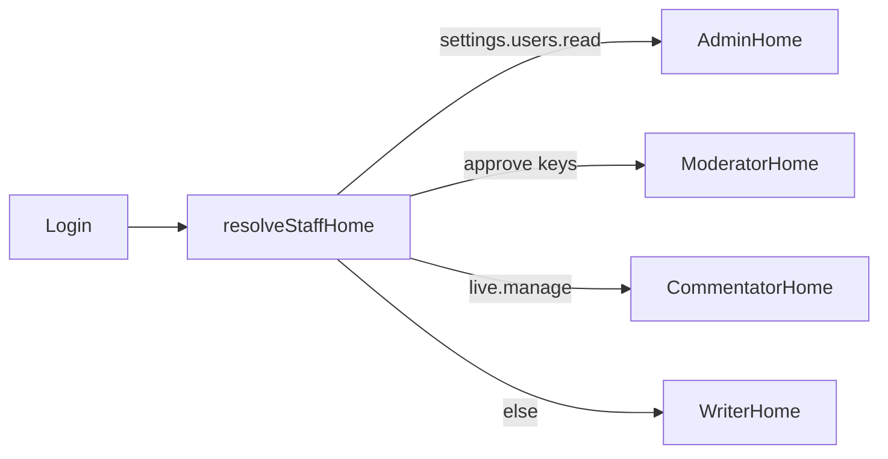

# Role dashboardi i full-page editori

Član (`/clanstvo`) se **ne dira**. Mobile se ne dira (writer već ima full-screen formu). Scope: admin web.

## A. Role home KPI (isključivo njihovo)

Resolver u `[frontend/src/lib/staff-home.ts](frontend/src/lib/staff-home.ts)` ostaje. Svaki home dobija: KPI strip (samo njihov posao) + brze akcije + radna lista. Shared: `[HomeKpiGrid](frontend/src/pages/admin/homes/HomeKpiGrid.tsx)`, `[RoleHomeShell](frontend/src/pages/admin/homes/RoleHomeShell.tsx)`. Fajlovi < 150 linija; nove liste/akcije u helperima.

**Writer** — `[WriterHome.tsx](frontend/src/pages/admin/homes/WriterHome.tsx)`

- KPI: nacrti, na odobrenju, objavljene, albumi (compose `useNewsList` + `useGalleryList`, bez novog API-ja)
- Brze akcije: Nova vijest → `/admin/news/new`, Novi album → `/admin/gallery/new`, Sve vijesti, Galerija
- Lista neobjavljenih (DRAFT+PENDING) sa linkom na `/admin/news/:id/edit`

**Komentator** — `[CommentatorHome.tsx](frontend/src/pages/admin/homes/CommentatorHome.tsx)`

- KPI: uživo, danas/predstojeće, izvještaji na predaju (postojeći `pickCommentatorDeskMatches`)
- Brze akcije: desk za sljedeću utakmicu, javni live, kalendar (`/admin/competitions`)
- Desk lista ostaje; CTA vodi na `/admin/live/:id`

**Moderator** — `[ModeratorHome.tsx](frontend/src/pages/admin/homes/ModeratorHome.tsx)`

- KPI (queue, ne admin brojke): vijesti pending, galerije pending, live izvještaji, inbox unread (`useContactMessages({ unreadOnly: true })`)
- Brze akcije: red vijesti / galerija / live / inbox
- Kratka lista stavki na odobrenju (naslov + odobri / otvori)

**Admin** — izdvojiti `AdminHome.tsx` iz `[DashboardPage.tsx](frontend/src/pages/admin/DashboardPage.tsx)`

- Gornji red: postojeći `[PlatformStatusTeaser](frontend/src/pages/admin/platform-status/PlatformStatusTeaser.tsx)`
- **Queue (wow / korisno):** pending članarine, pending vijesti, pending live, unread inbox — stvari koje čekaju akciju, ne suhi totali
- **Zdravlje kluba:** aktivna članstva, prodane ulaznice, objavljene vijesti (postojeći `[getKpis()](backend/src/dashboard/dashboard.service.ts)`)
- Brze akcije: CMS, korisnici, postavke, live pending, finance (ako ima `finance.read`)

Backend: proširiti `getKpis()` u `[dashboard.service.ts](backend/src/dashboard/dashboard.service.ts)` sa `pendingNews`, `pendingGalleries`, `pendingLive`, `pendingMemberships`, `unreadInbox` (isti permission `dashboard.read`). `[dashboard-kpi-config.ts](frontend/src/pages/admin/dashboard-kpi-config.ts)` split u queue vs health mape.

Showcase: ažurirati `home[]` u `[catalog-roles.ts](backend/src/showcase/catalog-roles.ts)` da prati nove tačke.

## B. Full-page editori umjesto sheetova

Dijalozi su uski (`AdminFormSheet` max ~56rem) — Tiptap + foto grid nemaju prostor.

Nove rute u `[app-routes.tsx](frontend/src/router/app-routes.tsx)` unutar postojećih `ModuleRoute` blokova:

- `/admin/news/new`, `/admin/news/:id/edit`
- `/admin/gallery/new`, `/admin/gallery/:id/edit`

Liste ostaju; **Nova / Uredi** postaju `Link`, sheetovi se brišu.

**Vijest** — 2 kolone `lg+`, stacked `< lg`:

- Lijevo (široko): naslov, uvod, Tiptap (viši `min-h`, već ima `className` na `[RichTextEditor](frontend/src/components/admin/RichTextEditor.tsx)`), cover
- Desno (sidebar ~320px): slug, kategorija, tagovi, SEO, galerija, schedule, related match/player
- Split `[NewsAdminFormFields.tsx](frontend/src/pages/admin/NewsAdminFormFields.tsx)` (147 linija) u `NewsEditorMain.tsx` + `NewsEditorMeta.tsx`; submit logika iz `[NewsAdminFormSheet.tsx](frontend/src/pages/admin/NewsAdminFormSheet.tsx)` ide u `NewsEditorPage.tsx` (<150 linija)
- Nakon create → navigate na `/admin/news/:id/edit`; dirty confirm na back

**Galerija** — full width:

- Header: naslov + opis + status
- Glavni prostor: foto grid (thumb veći, drag/reorder ostaje preko postojećih hookova) + `[GalleryPhotoPicker](frontend/src/components/admin/GalleryPhotoPicker.tsx)`
- Create: POST pa redirect na `:id/edit` da se slike dodaju odmah na širokom ekranu
- `[GalleryAdminPhotos.tsx](frontend/src/pages/admin/GalleryAdminPhotos.tsx)`: redovi 12px → grid kartice

Briše se: `NewsAdminFormSheet.tsx`, `GalleryAdminFormSheet.tsx`.

Liste `[NewsAdminPage.tsx](frontend/src/pages/admin/NewsAdminPage.tsx)` / `[GalleryAdminPage.tsx](frontend/src/pages/admin/GalleryAdminPage.tsx)`: `openCreate`/`openEdit` → `navigate`; klik na naslov → editor.

## C. Šta nije u scopeu

- `/clanstvo` i `MemberHomeStrip`
- Mobile staff/member ekrani
- CMS i drugi admin sheetovi (sponzori, igrači, …)
