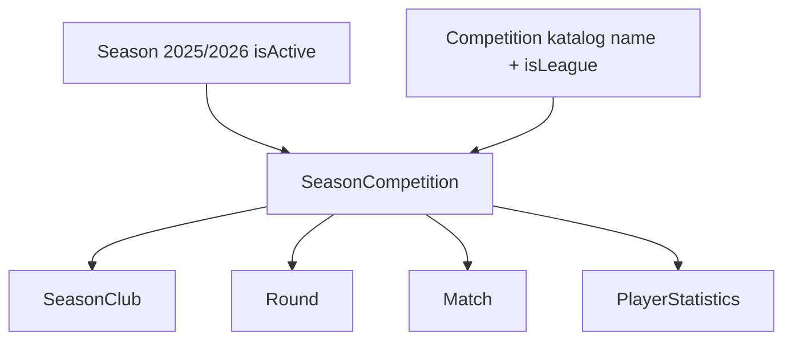

# Sezona kao roditelj takmičenja

## Ciljni model

- **Season**: jedan red po kalendarskoj sezoni (`name`, `yearStart`, `yearEnd`, `isActive`). Bez `competitionId`. Više sezona smije biti aktivno.
- **Competition**: katalog (naziv, slug, `isLeague`). Najviše jedno ligaško u katalogu, kao sada.
- **SeasonCompetition**: veza sezona + katalog. Unique `(seasonId, competitionId)`. Na ovaj red idu učesnici, kola, utakmice, player stats.

Admin tok:

1. Kreiraj sezonu `2025/2026`, aktivna da/ne.
2. Unutar sezone dodaj takmičenje iz kataloga **ili** novo (ime + ligaško) — to pravi `SeasonCompetition`.
3. Unutar tog izdanja: učesnici, kola, utakmice — postojeći hub.

## Migracija podataka (bitno)

Postojeći `Season` redovi **jesu izdanja** (liga 2025/26, kup 2025/26 = 2 reda). Ne diramo ID-eve kola/utakmica.

SQL koraci (nova migracija, npr. `season_as_parent`):

1. Kreirati `SeasonCompetition` s istim `id` kao trenutni `Season` (`competitionId` + novi `seasonId`).
2. Kreirati nove kalendarske `Season` redove: `GROUP BY yearStart, yearEnd` (ime `2025/2026`, `isActive` = OR grupisanih).
3. Backfill `SeasonCompetition.seasonId` na kalendarski red.
4. Prebaciti FK sa `Round.seasonId`, `Match.seasonId`, `SeasonClub.seasonId`, `PlayerStatistics.seasonId` sa stare `Season` tabele na `SeasonCompetition.id` (vrijednosti ID-eva ostaju iste).
5. Obrisati staru `Season` tabelu (ona s `competitionId`) i ostaviti novu kalendarsku `Season`.

Prisma nakon toga ([schema.prisma](backend/prisma/schema.prisma) ~L507–561, 659, 778):

- `Season` bez `competitionId`; relacija `competitions SeasonCompetition[]`
- `SeasonCompetition { seasonId, competitionId }` + `rounds`, `matches`, `participants`
- `Round` / `Match` / `SeasonClub` / `PlayerStatistics`: FK na `SeasonCompetition` (kolona u kodu: `seasonCompetitionId`; DB može ostati `seasonId` preko `@map` da SQL bude manji)

Seed: [clubs-competition.ts](backend/prisma/seed/demo/clubs-competition.ts) — jedan kalendar `2025/2026` + ligaško izdanje.

## API

Katalog ostaje na `/competitions`. Sezone i izdanja:

- `GET/POST/PATCH/DELETE /seasons` — kalendar
- `GET/POST /seasons/:id/competitions` — lista / dodaj izdanje (`competitionId` ili `{ name, isLeague }` + `clubIds`)
- `PATCH/DELETE /seasons/:id/competitions/:editionId` — učesnici
- Standings / matches / rounds i dalje primaju **edition id** kao `seasonId` query (postojeći klijenti: hub kola, statistike) — to je ID `SeasonCompetition`, isti kao danas za stare redove

Ukloniti `POST /competitions/seasons` koji zahtijeva `competitionId` na sezoni. [competitions.service.ts](backend/src/competitions/competitions.service.ts) razdvojiti: katalog + calendar seasons + editions (novi mali servis ako fajl preraste 200 linija).

[league-season.util.ts](backend/src/competitions/league-season.util.ts): `findDefaultLeagueEdition` = aktivna kalendarska sezona → `SeasonCompetition` gdje `competition.isLeague`, fallback najnovija.

[club-stats.service.ts](backend/src/clubs/club-stats.service.ts) `listClubParticipations`: `SeasonClub` → edition → calendar season + competition (umjesto `season.competition`).

Match include: `seasonCompetition: { include: { competition: true, season: true } }` u [matches.service.ts](backend/src/matches/matches.service.ts), live, SEO.

## Admin UI

[CompetitionsAdminPage.tsx](frontend/src/pages/admin/CompetitionsAdminPage.tsx) postaje dva nivoa, ne dvije ravne tabele:

- Lista **sezona** (naziv, period, aktivna). Akcija: otvori sezonu.
- Hub sezone (`/admin/seasons/:seasonId`): lista takmičenja-u-sezoni + “Dodaj takmičenje” (select kataloga ili novo). Po redu: učesnici, link na kola.
- Postojeći [SeasonHubPage.tsx](frontend/src/pages/admin/competition-hub/SeasonHubPage.tsx) ostaje za kola/utakmice, ruta npr. `/admin/seasons/:seasonId/competitions/:editionId`. Param koji danas zove `seasonId` u hubu postaje edition id.

Katalog takmičenja: mali CRUD (naziv + ligaško) na istoj admin stranici ili sheet, bez obaveze da odmah ima sezonu.

Mobile [competitions.tsx](mobile/app/staff/admin/competitions.tsx): ista hijerarhija (sezona pa izdanja), ne filter sezona po takmičenju.

## Public / mobile (pojednostavljenje)

Grupisanje po `yearStart/yearEnd` više nije potrebno kao zamjena za roditelja:

- [LeaguePage.tsx](frontend/src/pages/public/LeaguePage.tsx): picker kalendarskih sezona; standings iz ligaškog izdanja te sezone.
- [LeagueTableWidget.tsx](frontend/src/cms/widgets/LeagueTableWidget.tsx): default aktivna sezona; tabovi = izdanja te sezone (liga prva).
- [TeamSeasonStatsSection.tsx](frontend/src/components/team/TeamSeasonStatsSection.tsx) + [ClubCompetitionTabs.tsx](frontend/src/components/public/clubs/ClubCompetitionTabs.tsx): sezona = calendar; takmičenje = edition. [season-utils.ts](frontend/src/lib/season-utils.ts) / [club-participation.util.ts](frontend/src/lib/club-participation.util.ts) pojednostaviti (year-key helperi postaju `season.id`).
- Mobile [load-league-screen.ts](mobile/src/components/league/load-league-screen.ts) + [load-home-extras.ts](mobile/src/components/home/load-home-extras.ts): calendar season + league edition, ne `mapLeagueSeasons` preko `competition.isLeague` na starim Season redovima.

## Testovi i matrica

- Unit: merge kalendarskih sezona u migraciji (isti `yearStart/yearEnd` → jedan Season); unique `(seasonId, competitionId)`; default ligaško izdanje aktivne sezone.
- [MATRIX.md](.cursor/docs/matrices/competitions/MATRIX.md) + CHANGELOG: nova hijerarhija.

Implementacija u `.cursor/plans/season-as-parent/` (`00_overview.md`, faze, `CHECKLIST.md`, `CHANGELOG.md`) jer ima 4+ faze.

## Redoslijed

1. Šema + SQL migracija + generate + seed
2. Backend API (seasons, editions, stats, match include)
3. Admin web + mobile staff
4. Public web + mobile liga/home
5. Testovi + matrica
