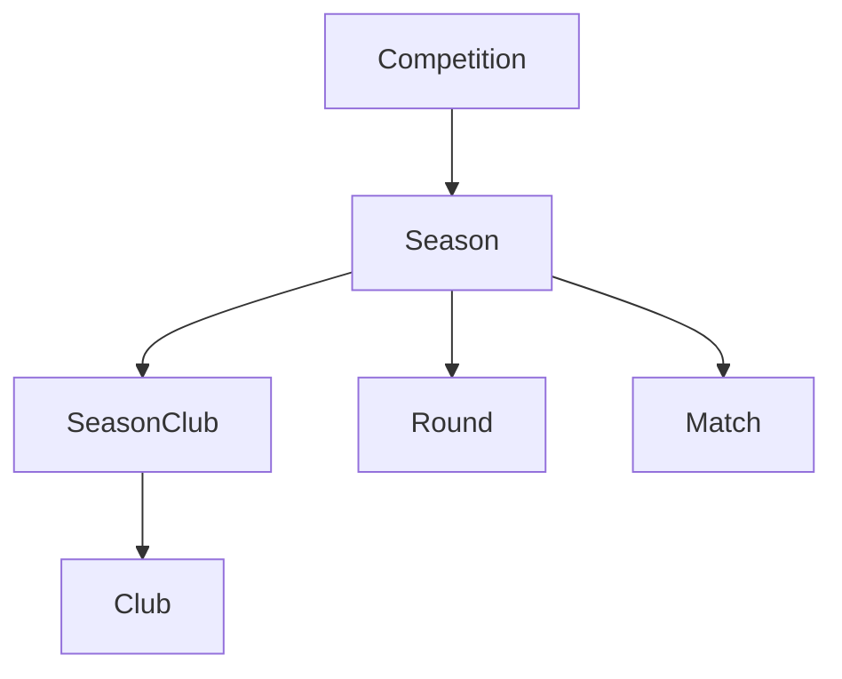
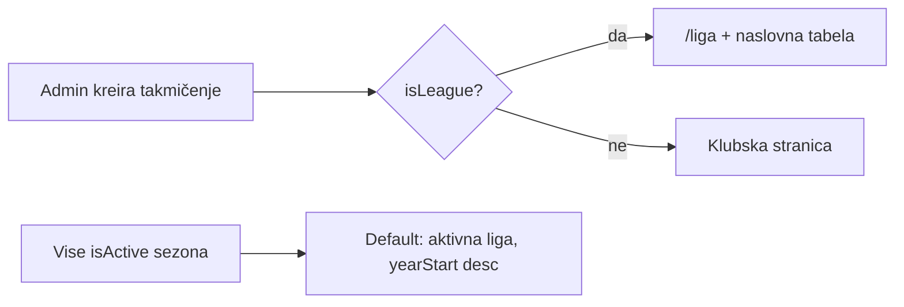

# Review i popravke modula Takmičenja

## Trenutno stanje (review)

Hijerarhija ostaje ista i već pokriva “više takmičenja u istoj sezoni”:

- [Competition](backend/prisma/schema.prisma) nema `type` / `isLeague`.
- [Season.isActive](backend/prisma/schema.prisma) postoji, ali [deactivateOtherSeasons](backend/src/competitions/season-active.util.ts) gasi sve ostale sezone **istog** takmičenja. Nova sezona 2026/2027 gasi 2025/2026 iako stara još traje (npr. do decembra).
- Klub već može biti u više sezona preko `SeasonClub` (Kup + liga + turnir). UI to ne prikazuje: [ClubStatsService](backend/src/clubs/club-stats.service.ts) uzima `findFirst({ isActive: true })` globalno; [ClubCompetitionTabs](frontend/src/components/public/clubs/ClubCompetitionTabs.tsx) prima jedan `seasonId`.
- `/liga` i naslovna ne filtriraju ligu: [LeaguePage](frontend/src/pages/public/LeaguePage.tsx) uzima sve sezone; [LeagueTableWidget](frontend/src/cms/widgets/LeagueTableWidget.tsx) i [LeagueTable](frontend/src/pages/home/sections/LeagueTable.tsx) uzimaju `seasons[0]` (najnoviji `yearStart`), što može biti kup/turnir.

**Bug završetka utakmice:** backend već prima `SCHEDULED → FINISHED` na `PATCH /matches/:id` ([assertManualMatchStatus](backend/src/matches/update-match.dto.ts) blokira samo LIVE/HALFTIME). Frontend u [MatchFormSheet.tsx](frontend/src/pages/admin/competition-hub/MatchFormSheet.tsx) L26 ima `editableStatuses = ['SCHEDULED', 'POSTPONED', 'CANCELLED']` — nema `FINISHED`. Rezultat se šalje dok je status `SCHEDULED`, pa se spremi rezultat, a utakmica ostane zakazana. Jedini put do `FINISHED` je live `endMatch()`.

Retro-kreiranje (“Utakmica u prošlosti”) već radi na create; nedostaje isti tok na **postojećoj** zakazanoj utakmici.

## Ciljni model (bez refaktora hijerarhije)

Sezona ostaje dijete takmičenja (nema globalni Season entitet). “Ista sezona” = više `Season` redova s istim `yearStart`/`yearEnd` (npr. Liga 2025/2026 + Kup 2025/2026).

- **Aktivna sezona:** više sezona istog takmičenja smije biti `isActive` (preklapanje 2025/26 i 2026/27).
- **Ligaško takmičenje:** `Competition.isLeague` — najviše jedno `true`. To takmičenje ide na `/liga` i tabelu na naslovnoj.
- **Ostala takmičenja:** uvid kroz klubsku stranicu (sve participacije kluba, uključujući ligu kao jedan tab).

---

## Faza 1 — Šema, sezone, admin liga

**Prisma** ([schema.prisma](backend/prisma/schema.prisma) ~L507): `isLeague Boolean @default(false)` na `Competition`. Migracija `competition-is-league`. Seed: `druga-liga-fbih` → `isLeague: true`.

**Sezone:** ukloniti pozive `deactivateOtherSeasons` iz [competitions.service.ts](backend/src/competitions/competitions.service.ts) L60 i L74–76. Switch “Aktivna” ostaje, ali ne gasi susjedne sezone.

**Liga flag:** util `ensureSingleLeagueCompetition` — kad se postavi `isLeague: true`, ostalima `isLeague: false`. Admin switch u [CompetitionsAdminFormSheet.tsx](frontend/src/pages/admin/CompetitionsAdminFormSheet.tsx) + badge na [CompetitionsAdminPage.tsx](frontend/src/pages/admin/CompetitionsAdminPage.tsx).

**Helper** `findDefaultLeagueSeason()` u novom `backend/src/competitions/league-season.util.ts`: aktivna ligaška sezona (`yearStart desc`), fallback najnovija ligaška.

---

## Faza 2 — Public / mobile / klub

Zamijeniti sve “prva sezona / prva aktivna globalno” sa ligaškim defaultom:

- [season-utils.ts](frontend/src/lib/season-utils.ts) — `pickDefaultSeasonId` filtrira `competition.isLeague` (response već uključuje `competition`).
- [LeaguePage.tsx](frontend/src/pages/public/LeaguePage.tsx) — picker samo ligaške sezone (aktivne i arhivske).
- [LeagueTableWidget.tsx](frontend/src/cms/widgets/LeagueTableWidget.tsx), [LeagueTable.tsx](frontend/src/pages/home/sections/LeagueTable.tsx) — default ligaška sezona, ne `seasons[0]`.
- [club-stats.service.ts](backend/src/clubs/club-stats.service.ts), [players.service.ts](backend/src/players/players.service.ts) — `findDefaultLeagueSeason` umjesto `isActive: true` globalno.
- Mobile: [load-league-screen.ts](mobile/src/components/league/load-league-screen.ts) + home snippet — isti filter.

**Klubska stranica:** u [club-public.service.ts](backend/src/clubs/club-public.service.ts) vratiti `participations` (`SeasonClub` + season + competition). [ClubCompetitionTabs](frontend/src/components/public/clubs/ClubCompetitionTabs.tsx) — tabovi po takmičenju (ime + sezona); default aktivna liga ako klub igra, inače najnovija aktivna participacija. Standings/kolo već idu preko `useStandings(seasonId)` / `useMatches(seasonId)`.

---

## Faza 3 — Završetak utakmice bez livea

**Frontend** ([MatchFormSheet.tsx](frontend/src/pages/admin/competition-hub/MatchFormSheet.tsx), već 258 linija — ekstrakt status helpera prije izmjene):

- `editableStatuses` uključuje `FINISHED`.
- BS labele: Zakazana / Odgođena / Otkazana / Završena.
- Na `FINISHED` zahtijevati datum u prošlosti + rezultat (isti UX kao retro-create).
- `SCHEDULED` i dalje šalje score samo ako status ostaje u listi; `FINISHED` šalje status + score.

**Backend** ([matches.service.ts](backend/src/matches/matches.service.ts) `update`):

- Dozvoliti `SCHEDULED | POSTPONED → FINISHED` (LIVE i dalje samo kroz komentatora).
- Validacija: datum u prošlosti, oba rezultata ≥ 0 (proširiti [match-retrospective.util.ts](backend/src/matches/match-retrospective.util.ts)).
- Na finish: `minute: 90` ako je 0; `reportStatus` ostaje `DRAFT` (kao retro-create) da se izvještaj kasnije može dopuniti.
- Tabela se računa iz `status: FINISHED` ([standings](backend/src/statistics/statistics.service.ts)) — odmah ulazi u `/liga`. Player stats i dalje tek nakon odobrenog izvještaja.

---

## Testovi i matrica

- Unit: više aktivnih sezona istog takmičenja; unique `isLeague`; `SCHEDULED → FINISHED` s prošlim datumom; odbijanje FINISHED u budućnosti.
- Matrica: `.cursor/docs/matrices/competitions/MATRIX.md` + `CHANGELOG.md`.

Migracija: Prisma `migrate-dev` (`competition-is-league`) iz `backend/`. Postojeća liga u produkciji se ručno označi u adminu (seed pokriva demo).
