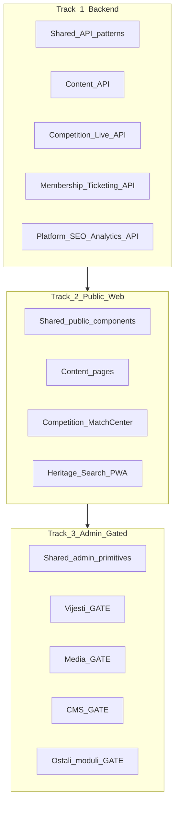

# FK Gračanica — Web Complete Master Plan

## Principi rada

- **Mobile (Expo) na pauzi** — radimo isključivo backend + web dok izričito ne kažeš drugačije.
- **Dva tracka, strogo redom:**
  1. **Track 1+2** — backend gapovi + javni web (bez admin polish-a)
  2. **Track 3** — admin moduli do konačne verzije, **jedan modul = jedan gate**
- **Gate pravilo:** ne prelazimo na sljedeći admin modul dok ne dobijem tvoju izričitu potvrdu da je trenutni završen i da se više ne vraćamo.
- **Izvori istine:** [HANDOFF.md](.cursor/plans/fk-gracanica/HANDOFF.md), [aplikacijski-plan.md](aplikacijski-plan.md), faze `13`–`20`, matrice u `.cursor/docs/matrices/`.
- **Tehnička pravila:** fajlovi ≤200 linija, Prisma promjene samo kroz migracije, bez placeholdera.

---

## Trenutno stanje (sažetak)

| Sloj | Realnost |
|------|----------|
| **Backend** | 27 modula ima controller+service; nema stubova, ali ima **ciljane rupe** (npr. `NewsCategory` CRUD ne postoji, gallery photo delete, live REST feed, ticketing cancel, membership suspend) |
| **Javni web** | 15 ruta postoji; većina je **read-only prikaz** bez punog sadržaja iz [aplikacijski-plan.md](aplikacijski-plan.md) (Match Center bez formacija/video/galerije, Liga bez top strijelaca, O klubu bez videa) |
| **Admin** | 21 ruta; **većina partial CRUD** — nema edit forme, media picker, rich text ([NewsAdminFormSheet.tsx](frontend/src/pages/admin/NewsAdminFormSheet.tsx) ima samo title/excerpt/content) |

---

## Track 0 — Plan artefakti (prije koda)

Kreirati folder [`.cursor/plans/fk-gracanica/21_web-complete/`](.cursor/plans/fk-gracanica/21_web-complete/):

| Fajl | Sadržaj |
|------|---------|
| `00_overview.md` | Ovaj plan + gate pravila |
| `01_track-backend.md` | Backend gap lista po modulu |
| `02_track-public-web.md` | Javne stranice + acceptance kriteriji |
| `03_track-admin-modules.md` | Redoslijed + checklist template |
| `CHECKLIST.md` | Master checkbox lista |
| `CHANGELOG.md` | Promjene po tracku |
| `GATE_LOG.md` | Tvoja odobrenja po modulu (datum + modul + status) |

---

## Track 1 — Backend completion (sve faze)

Cilj: svaki modul ima **kompletan, testabilan API** prema aplikacijskom planu — bez admin UI rada u ovom tracku.

### 1.1 Prisma / šema (samo gdje plan zahtijeva, a polje ne postoji)

**Vijesti** ([schema News](backend/prisma/schema.prisma) vs [aplikacijski-plan §Vijesti](aplikacijski-plan.md)):

- `videoUrl` (YouTube/embed URL)
- `galleryId` (opcionalna veza na album)
- junction tabele: `NewsMatch`, `NewsPlayer`
- `scheduledAt` (zakazano objavljivanje)
- `NewsCategory` CRUD modul (model postoji, API ne)

Ostali moduli: provjera polja po modulu pri ulasku u Track 3 (npr. `MuseumItem.category` enum, `Player` transfer history — samo ako uđe u modul checklist).

### 1.2 Backend gapovi po domenu

| Domen | Modul | Akcije |
|-------|-------|--------|
| **Content** | `news` | Category/tag CRUD; PATCH sa svim poljima; filter po kategoriji; veze match/player; scheduled publish job |
| | `gallery` | `DELETE :id/photos/:photoId`; reorder photos; paginacija liste |
| | `sponsors`, `trophies`, `club-timeline`, `hof`, `museum` | `GET :id`; paginacija admin lista; sortOrder gdje relevantno |
| | `contact` | `GET :id`, `DELETE`/archive |
| | `newsletter` | unsubscribe token endpoint; admin export |
| **Competition** | `matches` | `GET :id/lineup`; lineup u response |
| | `statistics` | `GET top-scorers`, `GET top-assists`, `GET cards-leaders` po sezoni |
| | `live` | `GET matches/:id/feed` (REST fallback za socket) |
| **Membership** | `membership` | `PATCH suspend/cancel`; `GET :id` admin |
| | `ticketing` | `GET orders/:id`; cancel order; paginacija admin; **member discount** logika |
| **Platform** | `rbac` | `POST/DELETE roles` (uz zaštitu system roles) |
| | `seo` | opcionalno: settings keys za per-page meta (bez novog modela) |
| | `notifications` | paginacija već postoji — provjera filtera |

### 1.3 Backend kvalitet (paralelno)

- DTO validacija (`class-validator`) na svim novim endpointima
- E2e testovi za kritične tokove: news workflow, gallery photos, live approve, ticketing reserve+cancel
- Ažurirati matrice: `rbac`, `ticketing`, `membership`, `live_center` kad se mijenja logika

**Exit kriterij Track 1:** `npm run build` + `npm test` + `npm run test:e2e` prolaze; Swagger dokumentuje sve nove rute.

---

## Track 2 — Javni web completion

Cilj: svaka javna ruta iz [App.tsx](frontend/src/App.tsx) ispunjava [aplikacijski-plan.md](aplikacijski-plan.md) — bez admin polish-a.

### 2.1 Shared public komponente

- `MediaImage` / lightbox (galerija)
- `VideoEmbed` (YouTube)
- `FormationPitch` (prvi tim — već djelomično u [FirstTeamPage.tsx](frontend/src/pages/public/FirstTeamPage.tsx))
- Paginacija na listama (vijesti, galerija)

### 2.2 Stranice — acceptance kriteriji

| Stranica | Šta nedostaje |
|----------|---------------|
| **Naslovna** | Hero iz CMS, sekcije vijesti/galerija/sponzori iz API-ja |
| **Vijesti** | Kategorije/tag filter; related content; video embed; galerija u članku |
| **Galerija** | Lightbox, lazy load, EXIF ako postoji u metadata |
| **O klubu** | Video segmenti, infinite scroll polish |
| **Prvi tim** | Kompletan profil igrača (modal/stranica), formacija iz API lineup |
| **Liga** | Tabela + forma + top strijelci/asistenti/kartoni (novi statistics endpointi) |
| **Match Center** | Sastavi, formacija, statistika, galerija, video, povezane vijesti |
| **Live** | Svi event tipovi u UI; YouTube embed ako postoji u settings |
| **HoF / Muzej** | Filter po godini/kategoriji, detalj modal |
| **Pretraga** | Već ima facete — dorada UX (autocomplete opcionalno) |
| **Kontakt** | OK — bez promjena osim polish |
| **Članstvo/ulaznice** | Javne stranice za registraciju člana i rezervaciju ulaznica (ako još ne postoje) |

**Exit kriterij Track 2:** `frontend npm run build` prolazi; ručni smoke na svih 15+ javnih ruta protiv produkcijskog API-ja.

---

## Track 3 — Admin deep polish (GATED)

### 3.0 Shared admin primitives (jednom, prije Vijesti)

Ove komponente gradimo **prije** prvog gated modula i koristimo u svim sljedećim:

| Komponenta | Fajl (predlog) | Namjena |
|------------|----------------|---------|
| `MediaPicker` | `frontend/src/components/admin/MediaPicker.tsx` | Odabir iz Media Library umjesto text path |
| `RichTextEditor` | `frontend/src/components/admin/RichTextEditor.tsx` | TipTap za sadržaj |
| `ConfirmDialog` | `frontend/src/components/admin/ConfirmDialog.tsx` | Zamjena `window.confirm` |
| `EntitySelect` | `frontend/src/components/admin/EntitySelect.tsx` | FK picker (klub, igrač, kategorija) |
| `SlugField` | `frontend/src/components/admin/SlugField.tsx` | Auto-slug iz naslova + ručna izmjena |

### 3.1 Redoslijed modula (potvrđeno: **Vijesti prvo**)

1. **Vijesti** ← START
2. Media Library
3. CMS blokovi
4. Galerija
5. Sponzori
6. Trofeji
7. Club Timeline
8. Igrači
9. Klubovi
10. Takmičenja + Sezone
11. Utakmice + Postava
12. Live / Komentator
13. Članstvo
14. Ulaznice
15. Kontakt inbox
16. Newsletter
17. Hall of Fame
18. Muzej
19. Korisnici + Role
20. Postavke
21. Audit + Notifikacije + Dashboard

### 3.2 Gate proces (za svaki modul)

1. Agent ispunjava **modul checklist** (backend + admin + javni prikaz ako relevantno)
2. Ručni smoke + screenshot lista
3. Ažurira `GATE_LOG.md` sa statusom `READY_FOR_REVIEW`
4. **Ti pregledaš** i daješ: `APPROVED — ne vraćamo se` ili `REVISE — lista stavki`
5. Tek nakon `APPROVED` → sljedeći modul

### 3.3 Checklist template (primjenjuje se na svaki modul)

- CRUD: create, read (list+detail), update, delete
- Workflow/statusi (draft/pending/published…) gdje postoji
- Media: upload/picker, renditions, alt/caption
- SEO: slug, meta title/description, OG preview
- Validacija + error poruke (BS)
- Paginacija, pretraga, filteri na listi
- RBAC: dugmad vidljiva samo uz permission
- Audit log na mutacijama (gdje već postoji infrastruktura)
- Javni prikaz ažuriran da koristi sva nova polja
- Nema raw UUID/path text inputa gdje postoji picker
- Test: barem 1 e2e ili integration za modul

### 3.4 Modul 1: Vijesti — detaljni scope (prvi gate)

**Backend** ([news.controller.ts](backend/src/news/news.controller.ts), [news.service.ts](backend/src/news/news.service.ts)):

- Migracija: `videoUrl`, `galleryId`, `scheduledAt`, junction `NewsMatch`/`NewsPlayer`
- `NewsCategory` modul: CRUD + seed kategorija
- PATCH sa: title, slug, excerpt, content (HTML), coverPath, videoUrl, categoryId, tags[], seoTitle, seoDesc, relatedMatchIds[], relatedPlayerIds[], galleryId, scheduledAt
- Auto-slug + unique validation
- Scheduled publish (jobs modul)
- Komentari admin: lista + delete (već postoji API)

**Admin** ([NewsAdminPage.tsx](frontend/src/pages/admin/NewsAdminPage.tsx)):

- Edit forma (ne samo create) — `NewsAdminFormSheet` → split u create/edit
- RichTextEditor za content
- MediaPicker za cover
- SlugField + SEO polja
- Category/tag multi-select
- EntitySelect za povezane utakmice/igrače
- Gallery picker
- Video URL polje + preview
- Workflow: draft → submit → approve → publish → archive (već djelomično)
- Scheduled publish datetime picker
- Paginacija + filter po statusu/kategoriji
- Komentari tab u edit sheetu

**Javni** ([NewsDetailPage.tsx](frontend/src/pages/public/NewsDetailPage.tsx)):

- Hero cover, video embed, inline galerija
- Related matches/players sekcija
- SEO/OG iz polja
- Komentari (već implementirano)

**Gate kriterij Vijesti:** admin može profesionalno kreirati, urediti, zakazati, objaviti i arhivirati vijest sa svim medijima i vezama — bez povratka na modul.

---

## Šta namjerno NIJE u scope-u (sada)

- Mobile (Expo) — na pauzi
- Online payment gateway — defer iz HANDOFF-a
- Push notifikacije / email kampanje — stub ili kasnije
- Admin export CSV — samo ako uđe u modul checklist po tvom zahtjevu

---

## Preporučeni red izvršavanja (prva sesija)

1. Kreirati plan folder `21_web-complete/` + `GATE_LOG.md`
2. Track 1.1 — Prisma migracija za News proširenja
3. Track 1.2 — News backend (category, relations, scheduled)
4. Track 0 primitives — MediaPicker + RichTextEditor (minimalno za Vijesti)
5. Track 3 — **Vijesti admin** do gate-ready
6. Track 2 — NewsDetail/List javni polish
7. Čekati tvoj gate review prije Media modula
